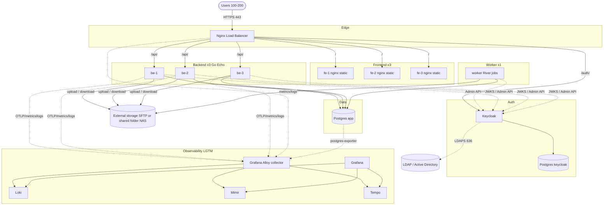
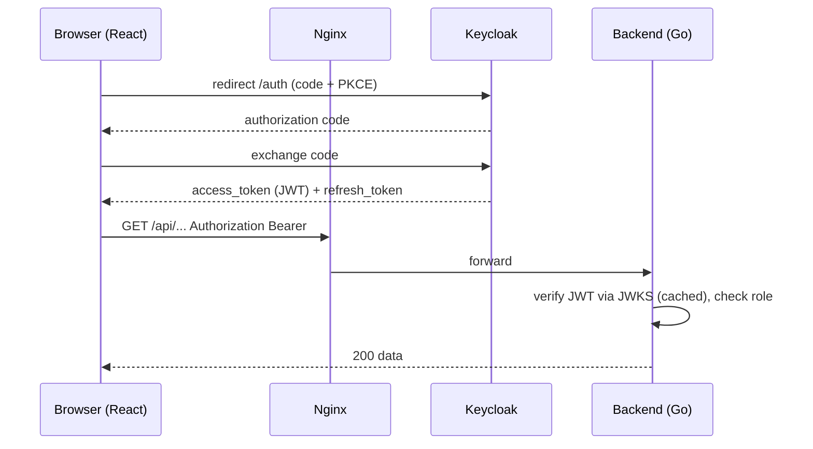
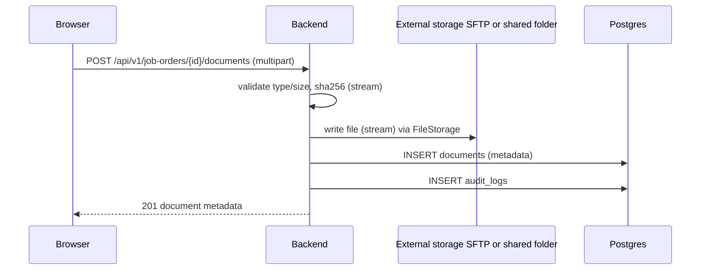
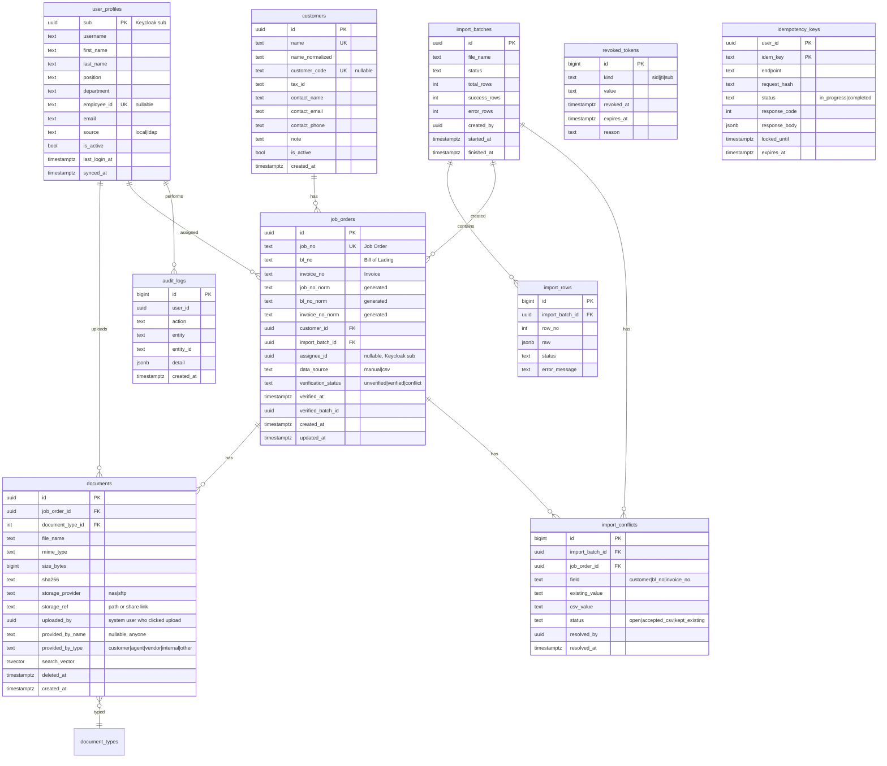
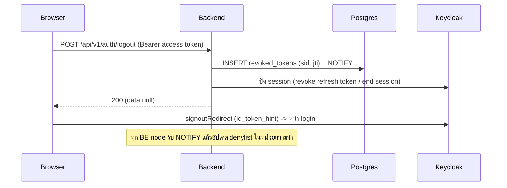
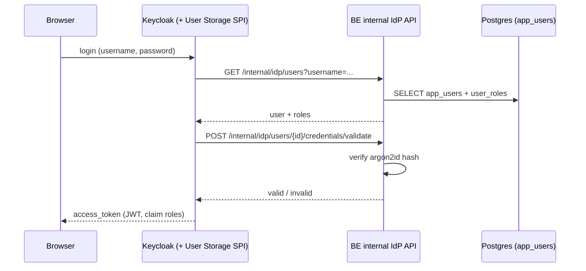

# Document Upload & Search System — Specification

> Version: 0.1 (Draft) | Type: Internal system | Runtime: Docker Compose on Colima

---

## 1. Overview

ระบบภายในสำหรับ **อัปโหลดและจัดเก็บเอกสาร** โดยอ้างอิงกับ Job Order แล้วให้ผู้ใช้ **ค้นหาเอกสารและรายงาน** ได้ภายหลัง ข้อมูลหลัก (Job Order, B/L, Invoice, Customer Name) นำเข้าผ่านไฟล์ CSV

### 1.1 Goals
- นำเข้าข้อมูลหลักจาก CSV อย่างถูกต้อง ตรวจสอบได้ ย้อนดูผลได้
- อัปโหลดเอกสารผูกกับ Job Order และค้นหาได้เร็ว
- ควบคุมสิทธิ์ด้วย Keycloak (SSO / RBAC)
- รองรับผู้ใช้พร้อมกัน 100–200 คน
- Auto recovery, Observability ครบ (LGTM), ทดสอบครบ 3 ระดับ

### 1.2 Non-Goals (เฟสนี้)
- OCR / ค้นหาในเนื้อหาเอกสาร (ยืนยันแล้ว: ไม่ทำ ค้นจาก Job Order / B/L / Invoice / Customer / ชื่อไฟล์เท่านั้น)
- Multi-region / Kubernetes
- Postgres / Keycloak HA (เป็นแผนอนาคต ดูหัวข้อ 11.5; เฟสนี้ใช้ 1 node + auto restart + backup/restore)
- Customer Portal / ผู้ใช้ภายนอก (ระบบสำหรับพนักงานภายในเท่านั้น)

### 1.3 Assumptions (กรุณายืนยัน)
1. CSV 1 แถว = 1 Job Order และ **1 Job Order : 1 B/L : 1 Invoice** (B/L และ Invoice เป็นฟิลด์ของ Job Order) ส่วน Customer 1 ราย มีได้หลาย Job Order
2. ข้อ 18 "แบ่งงานเป็น batch" = **รอบการพัฒนา (development batch)** ดูหัวข้อ 16 (การแบ่ง chunk ตอนประมวลผล CSV ในหัวข้อ 7 เป็นรายละเอียดทางเทคนิคแยกต่างหาก)
3. ข้อ 14 "ค้นหารายงาน" = ค้นหาเอกสาร + รายงานสรุป/Export (CSV) ตามเงื่อนไข
4. **BE ไม่เก็บเอกสารไว้เอง** — ส่งไปเก็บที่ storage ภายนอก 2 แบบ: SFTP หรือ Shared Folder (โฟลเดอร์ของ NAS ที่ mount เข้า container) ผ่าน `FileStorage` port (หัวข้อ 4.4); DB เก็บเฉพาะ metadata
5. ขนาดไฟล์สูงสุดต่อไฟล์ 50 MB, ชนิดไฟล์: PDF, JPG/PNG, DOCX, XLSX, CSV

---

## 2. Functional Requirements

| # | Feature | รายละเอียด | Role |
|---|---------|-----------|------|
| F1 | Import CSV | อัปโหลด CSV → validate → preview → commit เป็น batch, รายงาน error รายแถว | Admin, Staff |
| F2 | Upload เอกสาร | เลือก Job Order → อัปโหลดหลายไฟล์ + ระบุประเภทเอกสาร (B/L, Invoice, Packing List, อื่นๆ); ระบุผู้ส่งไฟล์ (`provided_by`) เป็นใครก็ได้ ไม่ต้องเป็นพนักงาน | Admin, Staff |
| F3 | AuthN/AuthZ | Keycloak OIDC (Auth Code + PKCE), RBAC | ทุก role |
| F4 | จัดการ User | รองรับผู้ใช้ 2 แหล่ง: (1) **Local users** สร้าง/แก้ไข/รีเซ็ตรหัสผ่าน/ปิดใช้งาน/กำหนด role ผ่านระบบ — เก็บใน Keycloak DB ผ่าน Admin API (หัวข้อ 8.1) (2) **LDAP/AD users** read-only (ดู/เปิด-ปิดสิทธิ์; แก้ข้อมูล/รหัสผ่านที่ AD) | Admin |
| F5 | จัดการ Customer | CRUD, merge ชื่อซ้ำ, ค้นหา | Admin, Staff |
| F6 | จัดการข้อมูลหลัก | CRUD / ดู / แก้ไข Job Order, B/L, Invoice ที่ import มา, ดูประวัติ import | Admin, Staff |
| F7 | ค้นหา | ค้นหาเอกสาร/ข้อมูลหลักด้วย keyword + filter | ทุก role |
| F8 | รายงาน | สรุปตาม Customer / ช่วงวันที่ / สถานะเอกสาร (เช่น Job Order ที่ยังไม่มีเอกสาร) + Export CSV | Admin, Staff, Viewer |
| F9 | Audit log | บันทึก upload/download/delete/import/แก้ไขข้อมูล | Admin |
| F10 | ฟอร์ม Job Order | สร้าง/แก้ Job Order + B/L + Invoice + Customer (เลือกหรือสร้างใหม่) + ผู้รับผิดชอบ (assignee) ด้วยมือ โดยไม่ต้องรอ CSV | Admin, Staff |
| F11 | ตรวจเทียบกับ CSV (reconcile) | เมื่อ import CSV ทีหลัง ระบบเทียบกับข้อมูลที่กรอกด้วยมือ (ตรงกัน/เติมช่องว่าง/ขัดแย้ง) และมีหน้าแก้ข้อมูลขัดแย้ง | Admin, Staff |

### 2.2 นิยาม "Customer" (ลูกค้า)

- **Customer = ลูกค้าทางธุรกิจที่เป็นเจ้าของ Job Order** (เช่น บริษัทผู้ส่งออก/นำเข้า) ค่าได้จากคอลัมน์ `Customer Name` ใน CSV
- **ไม่ใช่ User ของระบบ** — User คือพนักงานภายในที่ login ผ่าน Keycloak; Customer เป็นเพียงข้อมูลหลักที่ใช้จัดกลุ่ม/ค้นหา/ทำรายงาน
- ความสัมพันธ์: Customer 1 ราย : Job Order หลายรายการ
- สร้างอัตโนมัติตอน import CSV โดยเทียบชื่อที่ normalize แล้ว (trim, ยุบช่องว่าง, ไม่สนตัวพิมพ์เล็ก/ใหญ่)
- ฟังก์ชัน F5: เพิ่ม/แก้/ปิดใช้งาน, ค้นหา, **merge** กรณีสะกดชื่อไม่ตรงกันจนเกิดซ้ำ (ย้าย Job Order ทั้งหมดไปยังรายการหลัก)
- ฟิลด์ของ Customer: ชื่อ (บังคับ), รหัสลูกค้า, เลขประจำตัวผู้เสียภาษี, ชื่อผู้ติดต่อ, อีเมล, เบอร์โทร, หมายเหตุ (ที่เหลือไม่บังคับ; Customer ที่สร้างจาก CSV จะมีแค่ชื่อ แล้วเจ้าหน้าที่มาเติมภายหลัง)
- **ระบบนี้ใช้งานโดยพนักงานภายในเท่านั้น** — ไม่มี Customer Portal และไม่จำกัดสิทธิ์ตาม Customer ทุก role เห็นทุก Customer ตามสิทธิ์ใน 2.1

### 2.1 Roles & Permissions

> ตัดสินใจแล้ว: RBAC แบบ role คงที่ 3 ตัว (`admin` / `staff` / `viewer`) บังคับที่ BE middleware; การสร้าง role เองหรือสิทธิ์ละเอียด (permission-based) อยู่ใน backlog

| Permission | admin | staff | viewer |
|-----------|:----:|:----:|:----:|
| จัดการ User | ✅ | ❌ | ❌ |
| Import CSV | ✅ | ✅ | ❌ |
| CRUD Customer / ข้อมูลหลัก | ✅ | ✅ | ❌ |
| Upload เอกสาร | ✅ | ✅ | ❌ |
| ลบเอกสาร (soft delete) | ✅ | ❌ | ❌ |
| ค้นหา / ดาวน์โหลด | ✅ | ✅ | ✅ |
| ดู Audit log | ✅ | ❌ | ❌ |

### 2.3 Dashboard (หน้าหลัก)

**ตัดสินใจแล้ว**: หน้าแรกของทุก role = **แบบ A Search-first** + การ์ด **งานที่ต้องทำ (จากแบบ C)** สำหรับ admin/staff; viewer เห็นเฉพาะส่วนค้นหา ส่วนภาพรวม KPI (แบบ B) เป็น backlog (หน้า "ภาพรวม" สำหรับ admin) — ภาพออกแบบตัวอย่างอยู่ในเอกสารแยก (Dashboard Concepts)

| Widget | Role | ข้อมูล / API |
|---|---|---|
| ช่องค้นหา (ช่องเดียว + เลือกฟิลด์ + วางหลายเลข) | ทุก role | `/search` (หัวข้อ 10) |
| ค้นหาล่าสุด | ทุก role | เก็บฝั่ง FE (ต่อเครื่อง 10 รายการ) ไม่เก็บใน BE |
| เอกสารที่อัปโหลดล่าสุด | ทุก role | `GET /dashboard/recent-documents` (10 รายการ, metadata เท่านั้น) |
| ทางลัด (อัปโหลด, Import CSV, รายงาน) | ตามสิทธิ์ role | — |
| งานที่ต้องทำ: Job Order ที่ยังไม่มีเอกสาร B/L หรือ Invoice | admin, staff | `GET /dashboard/work-queue?filter=all\|missing_bl\|missing_invoice\|mine\|unassigned\|conflict\|unverified` |
| สถานะ Import ล่าสุด (progress) | admin, staff | `GET /imports?limit=1` (มีอยู่แล้ว) |
| กิจกรรมล่าสุด | admin, staff | `GET /dashboard/activity` (จาก `audit_logs` เฉพาะ action ที่เกี่ยวข้อง 10 รายการ) |
| แถบแจ้งเตือนสถานะระบบ (เช่น storage ช้า/ล่ม) | ทุก role | `GET /system/status` → `ok` / `degraded` / `down` ของ DB, storage (ไม่เปิดรายละเอียด infra); FE poll ทุก 30 วินาทีเมื่อแท็บ active |

- "ขาดเอกสาร" = Job Order ที่ไม่มีเอกสารที่ไม่ถูกลบของประเภท B/L (หรือ Invoice) ใช้ `NOT EXISTS` บน `documents` พร้อม index `(job_order_id, document_type_id) WHERE deleted_at IS NULL`; cache ผลใน BE 30–60 วินาที
- ตัวกรอง `mine` / `unassigned` ใช้ `job_orders.assignee_id` (หัวข้อ 2.4); `conflict` / `unverified` แสดง Job Order ที่ข้อมูลขัดแย้งกับ CSV หรือยังไม่ผ่านการตรวจเทียบ
- เป้า: endpoint ของ dashboard p95 < 300 ms; FE route `/` (`features/dashboard`), รองรับ TH/EN

### 2.4 Assignee, ผู้ส่งไฟล์, ฟอร์ม Job Order และการตรวจเทียบ CSV

**1) Assignee (ผู้รับผิดชอบ Job Order)**
- `job_orders.assignee_id` (Keycloak `sub`, ไม่บังคับ) ตั้ง/เปลี่ยนได้ในฟอร์ม และมอบหมายแบบกลุ่มได้ (`POST /job-orders/assign`); assignee ต้องเป็นผู้ใช้ที่ active และมี role admin/staff
- Import CSV **ไม่แตะ** assignee; ใช้กับตัวกรอง `mine` / `unassigned` ของ dashboard และค้นหา
- **ไม่ใช่สิทธิ์**: admin/staff คนใดก็อัปโหลดเอกสารให้ Job Order ใดก็ได้ ไม่ต้องเป็นผู้รับผิดชอบ; assignee ที่ถูกปิดใช้งานแสดงเป็น "ไม่ active" และ admin มอบหมายใหม่ได้

**2) ผู้ส่งไฟล์ (`provided_by`) แยกจากผู้อัปโหลด**
- ตัดสินใจแล้ว: **เจ้าหน้าที่อัปโหลดแทนทุกกรณี** และระบุผู้ส่งใน `provided_by`; คนภายนอกไม่อัปโหลดเอง (ลิงก์อัปโหลดสำหรับผู้ส่งภายนอกอยู่ใน backlog)
- `documents.uploaded_by` = ผู้ใช้ในระบบที่กดอัปโหลด (มาจาก token ระบบกำหนดเอง) ส่วน `provided_by_name` + `provided_by_type` (`customer` / `agent` / `vendor` / `internal` / `other`) = **ผู้ที่ส่งไฟล์มาจริง เป็นใครก็ได้ ไม่ต้องเป็นพนักงานหรือมีบัญชีในระบบ**
- ฟอร์ม upload มีช่อง "ผู้ส่ง" (ไม่บังคับ, ≤ 200 ตัวอักษร, autocomplete จากค่าที่เคยกรอก); ค้นหา/กรอง/รายงาน (`uploads-by-user`) ใช้ `provided_by` เป็นมิติเพิ่มได้

**3) ฟอร์ม Job Order (สร้างโดยไม่ต้องรอ CSV)**
- ฟิลด์: Job Order (บังคับ, unique), Customer (เลือกจากรายการหรือสร้างใหม่ในฟอร์ม), B/L, Invoice, assignee — บันทึกแล้วไปแท็บเอกสารเพื่ออัปโหลดต่อได้ทันที
- Job Order ที่สร้างด้วยมือ: `data_source=manual`, `verification_status=unverified`; `job_no` ซ้ำ → `409 CONFLICT` พร้อมลิงก์ไปรายการเดิม; B/L/Invoice ซ้ำ → เตือนแต่ไม่บล็อก
- แก้ไขด้วยมือหลัง `verified` แล้ว → กลับเป็น `unverified` (เพราะอาจไม่ตรงกับ CSV อีก) ทุกการแก้ไขบันทึก audit

**4) ตรวจเทียบกับ CSV (reconcile)** — key เทียบคือ `job_no`, เทียบค่าแบบ normalize

| ผลการเทียบ | เงื่อนไข | ตอน commit |
|---|---|---|
| `new` | ยังไม่มี `job_no` นี้ | สร้างใหม่ (`data_source=csv`, `verified`) |
| `matched` | มีอยู่ และ Customer / B/L / Invoice ตรงกันทั้งหมด | ตั้ง `verified` + `verified_at` / `verified_batch_id` ไม่แก้ข้อมูล |
| `fills_blank` | มีอยู่ ช่องที่ DB ว่างอยู่ CSV มีค่า และช่องที่มีค่าตรงกัน | เติมช่องว่าง + `verified` (audit) |
| `conflict` | ช่องที่ทั้งสองฝั่งมีค่า แต่ต่างกัน (Customer, B/L หรือ Invoice) | **ไม่ทับข้อมูลเดิม** ตั้ง `verification_status=conflict` และสร้าง `import_conflicts` |
| `error` | แถวผิดรูปแบบ | บันทึกใน `import_rows` ตามเดิม |

- Preview (dry-run) แสดงจำนวนของแต่ละผล + ดาวน์โหลดรายงานเทียบ (CSV)
- นโยบาย conflict ตอน commit (`conflict_policy`): `keep_existing` (ค่าเริ่มต้น) หรือ `use_csv` (เขียนทับด้วยค่าจาก CSV เก็บค่าเดิมใน audit)
- Job Order ที่ `data_source=csv` และ `verified` (ไม่ถูกแก้ด้วยมือ): CSV ใหม่อัปเดตทับตามปกติ เพราะ CSV เป็นข้อมูลหลัก
- หน้า "ข้อมูลขัดแย้ง": รายการ `import_conflicts` ที่ยังเปิดอยู่ เลือกทีละรายการหรือหลายรายการ → "ใช้ค่าจาก CSV" / "คงค่าเดิม" แล้วตั้ง `verified`; Job Order ที่ conflict มี badge และกรองได้; Customer ที่ชื่อต่างกัน: `use_csv` จะย้าย Job Order ไปยัง Customer ตามชื่อใน CSV (สร้างใหม่ถ้ายังไม่มี)
- Job Order ที่สร้างด้วยมือและยังไม่เคยอยู่ใน CSV คงสถานะ `unverified` และกรองดูได้ (`verification_status`)
- Import ไฟล์เดิมซ้ำได้ผล `matched` และไม่สร้าง conflict ซ้ำ (unique ต่อ job order + field + ค่า CSV ที่ยังเปิดอยู่)

---

## 3. Non-Functional Requirements

| หัวข้อ | เป้าหมาย |
|-------|---------|
| Concurrency | 100–200 concurrent users (ออกแบบรองรับ ~300 เผื่อ peak) |
| Latency (p95) | API ทั่วไป < 300 ms, Search < 500 ms, Upload 10 MB < 5 s (LAN) |
| Availability | Container ล้ม → กลับมาเองภายใน < 60 s; Nginx ตัด node เสียออกอัตโนมัติ |
| Durability | Backup Postgres รายวัน (ทดสอบ restore); การสำรองไฟล์เอกสารเป็นหน้าที่ของ NAS/SFTP server (snapshot/backup) และระบบเก็บ sha256 ไว้ตรวจความถูกต้อง |
| Security | OIDC, TLS (internal CA), validate ไฟล์, audit log |
| Observability | Logs/Metrics/Traces ครบด้วย LGTM |
| Data scale (ประมาณการ) | Job Order ~1M แถว, เอกสาร ~5M ไฟล์, รวม ~5 TB (ปรับตามจริง; ไฟล์อยู่บน storage ภายนอก ไม่นับ disk ของ Colima) |
| Retention | ยังไม่มีนโยบายตายตัว → ตั้งเป็น **ค่า config** (`DOCUMENT_RETENTION_DAYS`, ค่าเริ่มต้น `0` = เก็บถาวร ไม่ลบอัตโนมัติ); เมื่อกำหนดค่า > 0 มี scheduled job (River) ลบ/ย้ายเอกสารที่เก่าเกินกำหนดแบบ soft delete ก่อน แล้ว purge จริงหลัง grace period (`PURGE_GRACE_DAYS`, ค่าเริ่มต้น 30) และบันทึก audit log ทุกครั้ง |

---

## 4. System Design

### 4.1 Architecture



### 4.2 Request Flows

**Login (OIDC Authorization Code + PKCE)**


**Upload เอกสาร**


### 4.3 Capacity Plan (200 concurrent users)

- สมมติ 200 users × ~1 req/s peak ≈ **200 RPS** → 3 BE nodes รับได้สบาย (Go ~หลายพัน RPS/node สำหรับ CRUD)
- Postgres: `max_connections=200`, แต่ละ BE ใช้ pool สูงสุด **20** (รวม 60) + เผื่อ Keycloak/exporter/migration
- ถ้า connection ตึง ให้เพิ่ม PgBouncer (transaction mode; connection ของ `LISTEN` ต้องต่อตรง Postgres ดูหัวข้อ 8.4)
- Upload ใช้ streaming ไม่ buffer ทั้งไฟล์ใน memory; Nginx `proxy_request_buffering off`
- Host จริง: **4–6 CPU / 8–12 GB RAM** → Colima VM แนะนำ **4 vCPU, 8 GB RAM, 100+ GB disk** (ดู Resource Budget หัวข้อ 11.6; ถ้า host RAM 8 GB ใช้ Lite profile)
- Import CSV รันด้วย worker concurrency 1–2 และแนะนำให้ import นอกเวลาทำการ เพื่อไม่แย่ง CPU กับผู้ใช้

### 4.4 Document Storage (External)

BE และ worker **ไม่เก็บเอกสารเอง** (volume ของ Colima เก็บเฉพาะ Postgres/Keycloak/LGTM) แต่ส่งไปเก็บที่ storage ภายนอกผ่าน port `FileStorage`:
`Put(key, stream, size) → ref` · `Open(ref) → stream` · `Stat(ref)` · `Delete(ref)` · `Link(ref, ttl) → url`

รองรับ **2 แบบ เลือกด้วย config** `STORAGE_PROVIDER=sftp|shared_folder`

| | **`sftp`** | **`shared_folder`** |
|---|---|---|
| คืออะไร | อ่าน/เขียนผ่านโปรโตคอล SFTP | โฟลเดอร์แชร์ของ NAS (SMB/NFS) ที่ mount เข้า container เป็น path ปกติ |
| Config | `SFTP_HOST`, `SFTP_PORT`, `SFTP_USER`, `SFTP_KEY_FILE` (Docker secret), `SFTP_KNOWN_HOST` (pin host key), `SFTP_BASE_PATH`, `SFTP_MAX_CONNS` | `SHARED_FOLDER_PATH` (เช่น `/mnt/docstore`) + bind mount ใน compose |
| เขียนไฟล์ | `pkg/sftp` เขียนเป็น `.part` แล้ว rename | file I/O ปกติ เขียน `.part` แล้ว rename ในโฟลเดอร์เดียวกัน |
| จุดที่ต้องระวัง | connection pool/keepalive, timeout | mount ค้าง/หลุด (stale), สิทธิ์และ UID mapping, latency ของเครือข่าย |
| Health check | connect + stat `SFTP_BASE_PATH` | มีไฟล์ marker `.docsearch-mount` ที่ root (กันกรณี mount หลุดแล้วเขียนลง disk ในเครื่อง) |

**ใช้ร่วมกันทั้งสองแบบ**
- **ลิงก์ดาวน์โหลดเหมือนกัน**: ตัดสินใจแล้วว่า URL link พอ (ระบบภายใน) — BE ออก **signed link** `/api/v1/dl/{token}` (HMAC, อายุ ≤ 60 วินาที, ผูก user+เอกสาร) แล้ว stream ไฟล์ให้ browser; ตรวจสิทธิ์และ audit ตอนออกลิงก์และตอนใช้ ไม่เปิด link ของ NAS ตรง ๆ จึงคุมสิทธิ์ได้ทั้งสองโหมด; เปิดจาก `<a href>` ได้ (ไม่ต้องมี Authorization header)
- Config ใช้กับไฟล์ใหม่; `documents.storage_provider` เก็บต่อไฟล์ ทำให้เปลี่ยน provider ภายหลังแล้วไฟล์เก่ายังเปิดได้
- ทั้งสอง adapter ใช้ interface เดียวกันและผ่าน **storage contract tests** ชุดเดียวกัน (`shared_folder` ทดสอบด้วย temp dir, `sftp` ทดสอบด้วย testcontainers)
- Path: `{yyyy}/{mm}/{job_order_id}/{uuid}-{safe_name}`; ไฟล์ import: `imports/{batch_id}.csv`
- **ลำดับเขียนเพื่อความสอดคล้อง**: (1) stream ไป `.part` พร้อมคำนวณ sha256 → (2) rename เป็นชื่อจริง → (3) `INSERT documents` + audit ใน transaction → (4) ถ้า DB ล้มเหลวให้ลบไฟล์ (best effort)
- ไฟล์กำพร้า (อยู่ใน storage แต่ไม่มีแถวใน DB เกิน 24 ชม.) ถูกเก็บกวาดด้วย job ของ worker; ลบเอกสาร = soft delete ใน DB และลบไฟล์จริงด้วย retention purge job
- Resource: จำกัด concurrent transfer ต่อ node (เช่น 10), timeout, retry แบบ exponential เฉพาะ operation ที่ idempotent
- Availability: storage ล่ม/mount หลุด → upload/download ตอบ 503 แต่ search/metadata ใช้งานต่อได้ (ไม่รวมใน `/readyz`); มี metric latency/error และ alert
- Security: account/สิทธิ์เขียนเฉพาะโฟลเดอร์ของแอป, credential ใน Docker secret, SFTP ใช้ SSH key + pin host key, `shared_folder` mount แบบจำกัดสิทธิ์ (ไม่ใช้ guest/anonymous)
- **การ mount `shared_folder`** (ต้องตกลงกับทีมดูแล NAS): mount SMB/NFS ในระดับ Colima VM หรือ host แล้ว bind เข้า container ของ BE และ worker (ทั้ง 4 node ต้องเห็นโฟลเดอร์เดียวกัน); ตั้ง `restart` และ alert เมื่อ mount หลุด
- Backup/ความจุ: เป็นหน้าที่ของผู้ดูแล NAS/SFTP (snapshot/backup); แอปเก็บ `sha256` ไว้ตรวจความถูกต้อง; ต้องยืนยันความจุที่รองรับข้อมูลคาดการณ์ (~5 TB)

---

## 5. Tech Stack

### 5.1 Frontend
| ด้าน | เครื่องมือ |
|-----|-----------|
| Core | React 18 + TypeScript + Vite |
| Style | Tailwind CSS + shadcn/ui (Radix) + lucide-react |
| Routing | React Router v6 |
| Server state | TanStack Query |
| Table | TanStack Table (+ virtual scroll สำหรับข้อมูลเยอะ) |
| Form/Validation | React Hook Form + Zod |
| Auth | `react-oidc-context` (oidc-client-ts) |
| HTTP | axios (interceptor แนบ token / refresh) |
| Upload | react-dropzone (+ progress) |
| CSV preview | papaparse (preview ฝั่ง client เฉพาะ 100 แถวแรก) |
| i18n | react-i18next (TH/EN) |
| Test | Vitest + React Testing Library + MSW; E2E: Playwright |

### 5.2 Backend
| ด้าน | เครื่องมือ |
|-----|-----------|
| Core | Go 1.23 + Echo v4 |
| DB driver | pgx v5 (+ pgxpool) |
| Query | sqlc (type-safe SQL) |
| Migration | golang-migrate (หรือ goose) |
| Auth | `coreos/go-oidc/v3` verify JWT, `gocloak` เรียก Keycloak Admin API |
| Validation | go-playground/validator |
| Config | caarlos0/env หรือ viper |
| Logging | `log/slog` (JSON) + trace_id |
| Observability | OpenTelemetry SDK (traces/metrics) + prometheus client |
| File storage | `FileStorage` port: SFTP adapter (`github.com/pkg/sftp` + `x/crypto/ssh`), shared-folder adapter (filesystem) (หัวข้อ 4.4) |
| Job/Batch queue | **River** (Postgres-based, ไม่ต้องมี Redis) |
| API docs | swaggo/swag (OpenAPI) |
| Test | `testing` + testify + mockery + **testcontainers-go** (Postgres/Keycloak/SFTP server) |

### 5.3 Infra
Postgres 16, Keycloak 25+, Nginx, Grafana LGTM (Loki, Grafana, Tempo, Mimir) + Grafana Alloy, postgres-exporter, nginx-prometheus-exporter, cAdvisor, autoheal

### 5.4 Architecture Patterns

หลักการ: **เรียบง่าย แบ่งตาม feature** — ทีมเล็ก ระบบเป็น CRUD + search เป็นหลัก ผู้ใช้ 200 คน จึงไม่ใช้ microservices หรือ DDD เต็มรูปแบบ

#### Backend (Go): Modular Monolith + Layered ในแต่ละ feature
```
internal/<feature>/
├── handler.go      # HTTP (Echo): bind/validate request, เรียก service, map response
├── service.go      # business logic, transaction, เรียก repository/ports
├── repository.go   # เรียก sqlc (SQL), ไม่มี business logic
├── model.go        # domain types / DTO
└── ports.go        # interface ของ dependency ภายนอกที่ feature นี้ต้องใช้
```
- แยกตาม feature: `customer`, `joborder`, `document`, `importer`, `search`, `report`, `user`, `audit`
- กฎการพึ่งพา: `handler → service → repository`; service **ไม่ import Echo** และ **ไม่ import feature อื่นตรง ๆ** (คุยผ่าน interface ที่ประกาศฝั่งผู้ใช้)
- **Ports & Adapters เฉพาะ dependency ภายนอก**: `FileStorage` (SFTP/shared folder), Keycloak Admin API (`UserStore`), clock, ID generator → ใช้ mock ใน unit test; ส่วน DB ใช้ของจริงใน integration test
- Wiring แบบ manual (ไม่ใช้ DI framework) ที่ `cmd/server` และ `cmd/worker` (River worker ใช้ service ชุดเดียวกัน คนละ binary)
- Transaction เริ่มที่ service; error: domain error → จุด mapping เดียวเป็น HTTP code + error format มาตรฐาน
- `platform/` เก็บ cross-cutting: config, logger, OTel, DB pool, middleware (auth, request-id, audit)
- Contract: OpenAPI (swaggo) เป็นแหล่งความจริง → generate TypeScript client ให้ FE

#### Frontend (React): Feature-based
```
src/
├── app/            # providers, router, layout, auth setup
├── pages/          # ประกอบ feature เป็นหน้า (บาง ไม่มี logic ธุรกิจ)
├── features/<name>/{api,components,hooks,schemas}   # customer, import, document, search, report, users
├── components/ui/  # shadcn/ui ใช้ร่วม
└── lib/            # api client (generated), oidc, utils, i18n
```
- Server state ทั้งหมดใช้ **TanStack Query**; filter/pagination ของหน้า Search เก็บใน **URL** (แชร์ลิงก์ได้); ไม่มี global store ใหญ่ (ถ้าจำเป็นใช้ Zustand ขนาดเล็ก)
- Form: React Hook Form + Zod (schema ใน `features/*/schemas`)
- สิทธิ์: route guard + `<Can role>` เพื่อ UX เท่านั้น — **ฝั่ง BE เป็นตัวบังคับสิทธิ์จริง**
- Code splitting ระดับ route, virtual scroll สำหรับตารางใหญ่, feature ไม่ import กันตรง ๆ (ใช้ผ่าน `components`/`lib` หรือหน้า)

#### การทดสอบที่สอดคล้องกับ pattern
| ระดับ | Backend | Frontend |
|------|---------|----------|
| Unit | service (mock ports) | hook / component / util |
| Integration | handler + repository (testcontainers) | หน้า/feature + MSW |
| E2E | Playwright ผ่าน Nginx (ร่วมกัน) | |

---

## 6. Data Model



**หมายเหตุ**
- Customer: `customer_code` unique เมื่อมีค่า (partial unique index)
- `bl_no` / `invoice_no` ไม่บังคับ unique (ยังไม่ออกเอกสาร = NULL; ถ้าซ้ำตอน import ให้เตือนใน error report แต่ไม่บล็อก) (ยืนยันแล้ว)
- `job_orders.job_no` เป็น unique → import ซ้ำแล้ว upsert ได้ (idempotent); `bl_no` / `invoice_no` เป็นฟิลด์ใน Job Order (1:1:1) ไม่แยกตาราง
- Local users เก็บใน Keycloak DB (หัวข้อ 8.1) ไม่มีตารางผู้ใช้/รหัสผ่านในแอป ส่วน **LDAP/AD users** ไม่เก็บรหัสผ่านในระบบ; `audit_logs.user_id` และ `documents.uploaded_by` อ้างอิง Keycloak `sub` และ join ข้อมูลผู้ใช้จาก `user_profiles` (ดูหัวข้อ 8.3)
- ใช้ soft delete (`deleted_at`) กับ `documents`

### 6.1 Index สำหรับค้นหา
```sql
CREATE EXTENSION IF NOT EXISTS pg_trgm;
-- Job Order / B/L / Invoice เป็นคอลัมน์แยกกัน และเป็น 3 ฟิลด์ที่ค้นหาบ่อยที่สุด
-- เก็บค่าต้นฉบับไว้แสดงผล + คอลัมน์ normalize (trim + upper) สำหรับค้นหา
ALTER TABLE job_orders
  ADD COLUMN job_no_norm     text GENERATED ALWAYS AS (upper(btrim(job_no)))     STORED,
  ADD COLUMN bl_no_norm      text GENERATED ALWAYS AS (upper(btrim(bl_no)))      STORED,
  ADD COLUMN invoice_no_norm text GENERATED ALWAYS AS (upper(btrim(invoice_no))) STORED;

-- exact match + prefix (LIKE 'ABC%') -> btree
CREATE INDEX idx_jo_job_norm_bt  ON job_orders (job_no_norm     text_pattern_ops);
CREATE INDEX idx_jo_bl_norm_bt   ON job_orders (bl_no_norm      text_pattern_ops) WHERE bl_no IS NOT NULL;
CREATE INDEX idx_jo_inv_norm_bt  ON job_orders (invoice_no_norm text_pattern_ops) WHERE invoice_no IS NOT NULL;
-- contains (LIKE '%123%') -> trigram
CREATE INDEX idx_jo_job_norm_trgm ON job_orders USING gin (job_no_norm     gin_trgm_ops);
CREATE INDEX idx_jo_bl_norm_trgm  ON job_orders USING gin (bl_no_norm      gin_trgm_ops);
CREATE INDEX idx_jo_inv_norm_trgm ON job_orders USING gin (invoice_no_norm gin_trgm_ops);
CREATE INDEX idx_customers_name_trgm   ON customers USING gin (name_normalized gin_trgm_ops);
CREATE INDEX idx_documents_search      ON documents USING gin (search_vector);
CREATE INDEX idx_documents_job_order   ON documents (job_order_id) WHERE deleted_at IS NULL;
CREATE INDEX idx_documents_created_at  ON documents (created_at DESC);
-- list แบบ keyset: index ตรงกับ ORDER BY และมี id ท้ายสุดเป็น tie-breaker (ปรับตามผล EXPLAIN ANALYZE ใน B5-03)
CREATE INDEX idx_job_orders_created ON job_orders (created_at DESC, id DESC);
CREATE INDEX idx_audit_logs_created ON audit_logs (created_at DESC, id DESC);
```

---

## 7. CSV Import

### 7.1 รูปแบบไฟล์
| Column | Required | หมายเหตุ |
|-------|:-------:|---------|
| `JobOrder` | ✅ | trim, unique key ของ job |
| `B/L` (Bill of Lading) | ❌ | 1 Job Order : 1 B/L, ว่างได้ถ้ายังไม่ออกเอกสาร |
| `Invoice` | ❌ | 1 Job Order : 1 Invoice, ว่างได้ถ้ายังไม่ออกเอกสาร |
| `Customer Name` | ✅ | normalize (trim, ยุบ space, lower-case สำหรับ match) |

Encoding UTF-8 (รองรับ BOM) · Delimiter `,` · Header บังคับ · ขนาดสูงสุด 50 MB

### 7.2 Flow
1. **Upload** → เก็บไฟล์ต้นฉบับใน storage ภายนอก (prefix `imports/`) ผ่าน `FileStorage`, สร้าง `import_batches(status=pending)`
2. **Validate (dry-run)** → ตรวจ header, required fields, `JobOrder` ซ้ำในไฟล์เดียวกัน และ **เทียบกับข้อมูลที่มีอยู่ (reconcile: new / matched / fills_blank / conflict, หัวข้อ 2.4)** → แสดง preview + error
3. **Commit** → ตรวจว่า batch เป็น `ready` แล้ว **เปลี่ยนสถานะเป็น `queued` และส่ง job เข้า River queue ใน transaction เดียวกัน** (กันสถานะเป็น `processing` แต่ job ไม่เข้าคิว); ตอบกลับทันที (`202 Accepted` พร้อมสถานะ batch) งานทำเบื้องหลัง; commit ซ้ำคืนสถานะของ batch เดิมโดยไม่สร้าง job ซ้ำ; FE poll `GET /imports/{id}` เพื่อดู progress
4. **Worker** รับงาน **ทีละ batch** (คิว `import` ของ River ตั้ง concurrency = 1 เพื่อไม่ให้สอง batch เขียน `job_no` เดียวกันพร้อมกัน; batch ถัดไปรออยู่ใน `queued`) เปลี่ยนเป็น `processing` แล้วอ่านเป็น stream ประมวลผล **ทีละ chunk 1,000 แถว/transaction**
   - upsert `customers` → จัดการ `job_orders` (รวม `bl_no`, `invoice_no`) ตามผล reconcile และ `conflict_policy` โดยใช้ `job_no` เป็น key (หัวข้อ 2.4)
   - แถวผิดบันทึกใน `import_rows(status=error)` ไม่ล้มทั้ง batch
5. **สรุปผล** → `success_rows / error_rows`, ดาวน์โหลด error report (CSV) ได้
6. Worker ที่ crash → River retry (max 3), resume จาก chunk ล่าสุดที่ commit (idempotent upsert)

สถานะ: `pending → validating → ready → queued → processing → completed | completed_with_errors | failed`

> ยังไม่รองรับการยกเลิก batch ที่กำลัง `processing` (ข้อมูลที่นำเข้าไปแล้วไม่ถูกย้อนกลับ) — อยู่ใน backlog

---

## 8. Authentication & Authorization (Keycloak)

- Realm: `docsearch` · Client FE: `docsearch-web` (public, PKCE) · Client BE: `docsearch-api` (bearer-only / resource server)
- Realm roles: `admin`, `staff`, `viewer`
- BE middleware: verify signature (JWKS cache) → `iss`, `aud`, `exp` → **เช็ก denylist (หัวข้อ 8.4)** → map roles → check ต่อ route
- Access token อายุสั้น (5–10 นาที), refresh token ผ่าน FE
- จัดการ User (F4): Local users → BE เรียก Keycloak Admin API (8.1); LDAP users → BE เรียก Keycloak Admin API ด้วย service account (`docsearch-admin-svc`, สิทธิ์ `view-users`, `manage-users`) เพื่อดู/เปิด-ปิด/สั่ง sync
- Keycloak ใช้ database/user แยกจากแอป (อยู่ใน Postgres instance เดียวกันเพื่อประหยัด RAM; แยก instance ได้เมื่อทำ HA)
- Brute-force protection + password policy เปิดที่ Keycloak
- **แหล่งผู้ใช้ 2 แบบ**: Local users (หัวข้อ 8.1 เก็บใน Keycloak DB) และ LDAP/AD (หัวข้อ 8.2) เปิดใช้พร้อมกันได้
- Production-like: รัน Keycloak 1 node (internal) + auto restart; ถ้าต้อง HA เพิ่ม 2 node ใช้ Infinispan/JDBC_PING (นอก scope เฟสแรก)

### 8.1 Local Users — เก็บใน Keycloak DB (Option A, ตัดสินใจแล้ว)

ผู้ใช้ที่ไม่ได้มาจาก LDAP/AD สร้างและจัดการผ่านหน้า User ของระบบ โดย **BE เรียก Keycloak Admin API** ข้อมูลอยู่ใน Keycloak database (Postgres instance เดียวกับแอป แยก database/user) LDAP/AD (8.2) ใช้ร่วมกันได้

- BE ใช้ service account `docsearch-admin-svc` เรียก Admin API: สร้าง user, ตั้ง attribute (`firstName`, `lastName`, `position`, `department`, `employeeId`), ตั้งรหัสผ่านชั่วคราว (required action `UPDATE_PASSWORD`), เปิด/ปิดใช้งาน, กำหนด realm role
- Role เป็น realm role (`admin` / `staff` / `viewer`) → อยู่ใน token claim `realm_access.roles` (ทั้ง local และ LDAP users ใช้ claim เดียวกัน)
- ฟิลด์เพิ่มของ user ใช้ **User Profile attribute** ของ Keycloak (แก้ไขได้เฉพาะ admin) และ **ห้ามแก้ตารางของ Keycloak โดยตรง**
- ชื่อผู้ใช้ unique ต่อ realm (Keycloak บังคับ) — ตรวจชื่อซ้ำกับ LDAP ก่อนสร้าง; `employee_id` ต้องไม่ซ้ำ ตรวจใน `user_profiles` ก่อนสร้าง/แก้ไข
- รายงานและการ join ใช้ `user_profiles` snapshot (8.3) ไม่เรียก Keycloak ตอนทำรายงาน
- นโยบายรหัสผ่าน (ยาว ≥ 12, ห้ามซ้ำกับรหัสเก่า), brute-force protection, session/token ตั้งที่ Keycloak
- Keycloak database ต้องอยู่ใน backup (`pg_dump` รายวัน) และทดสอบ restore ร่วมกับ DB ของแอป
- BE ออกแบบผ่าน interface `UserStore` เพื่อให้เปลี่ยนที่เก็บข้อมูลในอนาคตได้ง่าย

**เหตุผลที่เลือก**: ไม่ต้องดูแล Java SPI, อัปเกรด Keycloak ง่าย, login พึ่งพา Keycloak ตัวเดียว และ `user_profiles` แก้ปัญหา join รายงานแล้ว
**ทางเลือกที่ไม่เลือก**: Option B (app DB + User Storage SPI) — เก็บรายละเอียดไว้ที่ Appendix A เผื่อเปลี่ยนในอนาคต (ต้อง migrate ผู้ใช้และรีเซ็ตรหัสผ่าน)

### 8.2 LDAP / Active Directory Federation (ยืนยันแล้วว่าต้องใช้)

บัญชีพนักงานมาจาก LDAP/AD ขององค์กร โดยให้ **Keycloak เป็นตัวกลาง** (User Federation) แอป/BE ไม่คุยกับ AD โดยตรง

- Provider: Keycloak User Federation → `ldap`, mode **READ_ONLY**, เชื่อมด้วย **LDAPS (636)** + import CA certificate ของ AD เข้า Keycloak truststore
- Bind ด้วย service account แบบ read-only; เก็บ credential ใน Docker secret
- Login: ผู้ใช้กรอก username/password ที่หน้า Keycloak → Keycloak ตรวจกับ AD (password ไม่ผ่านแอป)
- Attribute mapping: `sAMAccountName` (หรือ `userPrincipalName`) → username, `mail`, `givenName`, `sn`, `displayName`
- **Role จาก AD Group (ตัดสินใจแล้ว)**: map AD group → realm role (`admin` / `staff` / `viewer`) ด้วย group/role mapper; ผู้ใช้ที่ไม่อยู่ในกลุ่มใด → ไม่มีสิทธิ์เข้าระบบ
- Sync: import ตอน login ครั้งแรก + periodic sync ทุก 1 ชั่วโมง (ปรับได้) + sync ทันทีผ่านปุ่มของ Admin; ผู้ใช้ที่ถูกปิด/ลบที่ AD จะ login ไม่ได้ตั้งแต่ครั้งถัดไป และ token เดิมหมดอายุตามอายุ token (5–10 นาที)
- หน้า User ในแอป: ดู/ค้นหา, ดู role, เปิด-ปิดสิทธิ์ใช้งานระบบ; **ไม่สร้างหรือรีเซ็ตรหัสผ่านให้ user จาก AD**
- **Break-glass**: มี local admin 1–2 บัญชีใน Keycloak (รหัสผ่านเก็บแยก) ใช้เข้าระบบเมื่อ AD เข้าไม่ได้
- AD ล่ม: ผู้ที่ login อยู่ใช้งานต่อได้จน token/session หมดอายุ; login ใหม่ไม่ได้ (ยกเว้น local admin); เพิ่ม alert เมื่อ LDAP bind ล้มเหลว
- Colima VM ต้องมีเครือข่ายไปถึง AD server (DNS + port 636) — ต้องตรวจก่อนเริ่ม Batch 1
- ตัวทดสอบ: ใช้ OpenLDAP container จำลอง AD ใน integration/E2E test

### 8.3 User Profile Snapshot (ข้อมูลผู้ใช้สำหรับรายงาน)

**ปัญหา**: ข้อมูลผู้ใช้อยู่ที่ Keycloak (หรือ AD) จึง join กับเอกสาร/audit ใน SQL ไม่ได้ และเรียก Admin API ทีละคนต่อแถวรายงานจะช้า
**แนวทาง**: เก็บสำเนา (snapshot) ใน `user_profiles` ของแอป โดยใช้ Keycloak `sub` เป็น key — รายงานและหน้าค้นหา join ตารางนี้เท่านั้น ไม่เรียก Keycloak ตอนทำรายงาน

| ฟิลด์ใน `user_profiles` | LDAP/AD attribute | Keycloak User Profile attribute (user ที่สร้างในระบบ) | token claim |
|---|---|---|---|
| `first_name` | `givenName` | `firstName` | `given_name` |
| `last_name` | `sn` | `lastName` | `family_name` |
| `position` (ตำแหน่ง) | `title` | `position` | `position` |
| `department` (แผนก) | `department` | `department` | `department` |
| `employee_id` (รหัสพนักงาน) | `employeeID` (หรือ `employeeNumber`) | `employeeId` | `employee_id` |
| `email` | `mail` | `email` | `email` |

- ตั้งค่าใน Keycloak: เพิ่ม attribute `position`, `department`, `employeeId` ใน **User Profile** (แก้ไขได้เฉพาะ admin) + LDAP attribute mapper + protocol mapper (User Attribute → claim) บน client `docsearch-web`
- `source` (`local`/`ldap`) ได้จากชนิด provider ของ user

**กลไก sync**
1. **ตอน login/เรียก API**: BE upsert จาก claim ใน token (เขียนเมื่อค่าเปลี่ยน และไม่ถี่กว่า 1 ครั้ง/5 นาที/user)
2. **Job รายวัน** (River, 02:00): ดึง user ทั้งหมดผ่าน Keycloak Admin API ทีละหน้า (200/หน้า) แล้ว upsert — ครอบคลุมผู้ที่ยังไม่เคย login; ผู้ที่หายไปหรือถูกปิด → `is_active=false` **ไม่ลบแถว** เพื่อให้รายงานย้อนหลังยังแสดงชื่อได้
3. **ทันที**: เมื่อ Admin สร้าง/แก้ user ผ่านหน้า User และปุ่ม **Sync now** (`POST /api/v1/users/sync`)

**การใช้ในรายงาน**
```sql
CREATE INDEX idx_user_profiles_dept ON user_profiles (department);
CREATE INDEX idx_user_profiles_name_trgm
  ON user_profiles USING gin ((first_name || ' ' || last_name) gin_trgm_ops);

-- ตัวอย่าง: เอกสารที่อัปโหลดแยกตามแผนก/ผู้ใช้
SELECT u.department, u.employee_id, u.first_name, u.last_name, u.position,
       count(*) AS uploads
FROM documents d
JOIN user_profiles u ON u.sub = d.uploaded_by
WHERE d.deleted_at IS NULL AND d.created_at >= $1 AND d.created_at < $2
GROUP BY 1,2,3,4,5
ORDER BY uploads DESC;
```
- รายงานแสดงแผนก/ตำแหน่ง **ปัจจุบัน** ของผู้ใช้; ถ้าต้องการค่า **ณ วันที่ทำรายการ** ให้เก็บ snapshot (ชื่อ, แผนก, ตำแหน่ง) ไว้ในแถว `documents`/`audit_logs.detail` ตอนทำรายการ (ตัวเลือก ยังไม่รวมใน ERD)
- ข้อมูลส่วนบุคคลของพนักงาน (PDPA): หน้า/รายงานที่แสดงรหัสพนักงานและตำแหน่งจำกัดเฉพาะ admin/staff, viewer เห็นเฉพาะชื่อ-สกุล; ไม่ใส่ฟิลด์เหล่านี้ใน log

### 8.4 Logout & Token Revocation (JWT Denylist)

**ปัญหา**: JWT เป็น stateless — หลัง logout access token เดิมยังใช้ได้จนหมดอายุ จึงเพิ่ม **denylist** ฝั่ง BE ให้ token ที่ถูกเพิกถอนใช้ไม่ได้ทันที

**สิ่งที่เพิกถอนได้ (3 ชนิด)**

| kind | ใช้เมื่อ | ผล |
|------|---------|----|
| `sid` (Keycloak session id) | Logout ปกติ / Keycloak ปิด session | ทุก access token ของ session นั้นใช้ไม่ได้ (ครอบคลุมหลังการ refresh) |
| `jti` (token id) | เพิกถอน token เดี่ยว | token นั้นใช้ไม่ได้ |
| `sub` + เวลา cutoff | Admin ปิดใช้งาน/ลบ user, รีเซ็ตรหัสผ่าน, (ตัวเลือก) เปลี่ยน role | token ของ user ที่ออกก่อนเวลา cutoff (`iat` < `revoked_at`) ใช้ไม่ได้ |

**Logout flow**


**การเก็บและตรวจ (ไม่เพิ่ม Redis)**
- เก็บใน Postgres ตาราง `revoked_tokens (kind, value, revoked_at, expires_at, reason)` — unique (`kind`, `value`)
- แต่ละ BE node โหลดรายการที่ยังไม่หมดอายุเข้า **หน่วยความจำ** ตอน start และอัปเดตผ่าน **`LISTEN/NOTIFY`** (channel `token_revoked`); ถ้า connection หลุดให้ reconnect + poll ทุก 5 วินาทีจนกลับมา → การตรวจต่อ request ไม่ต้อง query DB
- ความหน่วงที่ยอมรับ: เพิกถอนมีผลทุก node ภายใน ≤ 2 วินาที
- `NOTIFY` ไม่ถูกเก็บ (ข้อความหายถ้า node ไม่ได้ฟังอยู่) และส่งเฉพาะหลัง commit — ตาราง `revoked_tokens` คือแหล่งความจริง ส่วน `NOTIFY` ทำให้ซิงก์เร็วขึ้น
- **Connection ของ `LISTEN` ต้องเป็น connection ถาวรที่ต่อตรงเข้า Postgres (ไม่ผ่าน PgBouncer แบบ transaction mode)** เพราะ transaction pooling ไม่รองรับ `LISTEN`; แต่ละ BE node ใช้ 1 connection แยกจาก pool ปกติ (นับรวมใน `max_connections`)
- `expires_at` = `exp` ของ token (สำหรับ `jti`) หรือ now + อายุ access token สูงสุด + 60 วินาที (สำหรับ `sid`/`sub`); job River ลบแถวหมดอายุทุก 10 นาที
- Middleware: ตรวจลายเซ็น/`exp` ก่อน แล้วเช็ก `jti`, `sid`, `sub` cutoff → ถูกเพิกถอนตอบ HTTP `401` code `4011` (TOKEN_REVOKED)

**Keycloak ที่ต้องตั้ง**
- Access token อายุ 5 นาที (ยิ่งสั้นยิ่งลดขนาด denylist)
- เปิด **Revoke Refresh Token** (refresh token ใช้ครั้งเดียว) และตรวจว่า access token มี claim `jti` และ `sid` (เพิ่ม mapper ถ้าไม่มี)
- ตั้ง **Backchannel Logout URL** ของ client `docsearch-web` → BE `/internal/auth/backchannel-logout` (ครอบคลุมกรณี logout จากแหล่งอื่น, session หมดอายุ, Admin กด logout/ปิด user ใน Keycloak)

**Endpoint**
- `POST /api/v1/auth/logout` — ต้องล็อกอิน; เพิ่ม `sid`+`jti` ลง denylist, สั่ง Keycloak ปิด session, บันทึก audit
- `POST /internal/auth/backchannel-logout` — Keycloak เรียก (รับ `logout_token`: ตรวจลายเซ็น, `iss`, `aud`, claim `events`, มี `sid`); **ไม่เปิดสู่ภายนอก** (ฟังพอร์ตภายใน/เครือข่าย compose เท่านั้น)
- เมื่อ Admin ปิด/ลบ user หรือรีเซ็ตรหัสผ่านผ่านหน้า User → BE เพิ่ม `sub` cutoff อัตโนมัติ

**Frontend**: ปุ่ม Logout → เรียก `/auth/logout` → `signoutRedirect()` พร้อม `id_token_hint` → ล้าง TanStack Query cache; ใช้ `BroadcastChannel` ให้ทุกแท็บ logout พร้อมกัน; ถ้าได้ code `4011` (TOKEN_REVOKED) หรือ `4010` ให้พาไปหน้า login

**Observability/Audit**: audit log ทุกครั้งที่ logout/เพิกถอน, metric `auth_revoked_total{kind}`, gauge `auth_denylist_size`, log ต้องไม่มีตัว token

---

## 9. API Design (REST, prefix `/api/v1`)

| Method | Path | คำอธิบาย | Role |
|-------|------|---------|------|
| GET | `/me` | ข้อมูลผู้ใช้ปัจจุบัน | all |
| POST | `/auth/logout` | logout + เพิกถอน token (denylist, หัวข้อ 8.4) | all |
| POST | `/internal/auth/backchannel-logout` | Keycloak แจ้ง logout (ภายในเท่านั้น ไม่ผ่าน Nginx สาธารณะ) | internal |
| GET/POST | `/users` | list (Local + LDAP, มีคอลัมน์ source) / create (Local users) | admin |
| GET/PUT/DELETE | `/users/{id}` | ดู / แก้ / ปิดใช้งาน | admin |
| PUT | `/users/{id}/roles` | กำหนด role (Local users; LDAP users ใช้ AD group) | admin |
| POST | `/users/sync` | sync ข้อมูลผู้ใช้จาก Keycloak เข้า `user_profiles` ทันที | admin |
| GET/POST | `/customers` | list / create | staff+ |
| GET/PUT/DELETE | `/customers/{id}` | | staff+ |
| POST | `/customers/{id}/merge` | รวมลูกค้าซ้ำ | admin |
| POST | `/imports` | อัปโหลด CSV (ต้องมี `Idempotency-Key`) | staff+ |
| GET | `/imports` , `/imports/{id}` | รายการ / สถานะ | staff+ |
| POST | `/imports/{id}/commit` | เริ่ม process เบื้องหลัง (ตอบ `202 Accepted` พร้อมสถานะ batch; commit ซ้ำคืน batch เดิม; body `conflict_policy`: `keep_existing` (ค่าเริ่มต้น) \| `use_csv`) | staff+ |
| GET | `/imports/{id}/reconcile` | สรุปผลเทียบ (new/matched/fills_blank/conflict) + รายการ | staff+ |
| GET | `/import-conflicts` | รายการข้อมูลขัดแย้งที่ยังเปิดอยู่ | staff+ |
| POST | `/import-conflicts/resolve` | ตัดสิน `use_csv` / `keep_existing` รายการเดียวหรือเป็นกลุ่ม | staff+ |
| POST | `/job-orders/assign` | มอบหมายผู้รับผิดชอบ (assignee) แบบกลุ่ม | staff+ |
| GET | `/imports/{id}/errors.csv` | ดาวน์โหลด error | staff+ |
| GET/POST | `/job-orders` | list / create | staff+ |
| GET/PUT/DELETE | `/job-orders/{id}` | รวมฟิลด์ B/L, Invoice | staff+ |
| POST | `/job-orders/{id}/documents` | upload (multipart, **1 ไฟล์ต่อ request**; FE ส่งหลายไฟล์ขนานได้ ≤ 3; ต้องมี `Idempotency-Key`); ฟิลด์ `provided_by_name`, `provided_by_type` ไม่บังคับ | staff+ |
| GET | `/documents/{id}` | metadata | all |
| GET | `/documents/{id}/download-link` | คืน URL ดาวน์โหลด (signed link `/dl/{token}` ทั้ง SFTP และ shared folder) หลังเช็กสิทธิ์ + audit | all |
| GET | `/dl/{token}` | ดาวน์โหลดผ่าน signed link อายุสั้น (ทุกโหมด storage) ไม่ต้องมี Authorization header | token |
| DELETE | `/documents/{id}` | soft delete | admin |
| GET | `/search` | ค้นหารวม (`q`, `customer`, `type`, `from`, `to`, `page`, `size`, `sort`) | all |
| GET | `/reports/job-orders-summary` | สรุปตาม customer/ช่วงเวลา | all |
| GET | `/reports/missing-documents` | Job Order ที่ขาดเอกสาร | all |
| GET | `/reports/uploads-by-user` | จำนวนเอกสารที่อัปโหลดแยกตามผู้ใช้/แผนก/ช่วงเวลา (ชื่อ-สกุล, ตำแหน่ง, แผนก, รหัสพนักงาน) | admin, staff |
| GET | `/dashboard/recent-documents` | เอกสารที่อัปโหลดล่าสุด 10 รายการ | all |
| GET | `/dashboard/work-queue` | Job Order ที่ขาดเอกสาร B/L หรือ Invoice (filter, แบ่งหน้า) | admin, staff |
| GET | `/dashboard/activity` | กิจกรรมล่าสุด 10 รายการ | admin, staff |
| GET | `/system/status` | สถานะ DB/storage แบบสรุปสำหรับแถบแจ้งเตือน | all |
| GET | `/reports/*/export.csv` | Export | all |
| GET | `/audit-logs` | | admin |
| GET | `/healthz` , `/readyz` | liveness / readiness (ไม่ต้อง auth) | — |
| GET | `/metrics` | Prometheus (ปิดจากภายนอก) | internal |

**Response มาตรฐาน (Envelope)**

JSON API ทุก endpoint ตอบรูปแบบเดียวกัน `{ code, message, data }` (+ `meta` เมื่อเป็น list แบ่งหน้า) และ **สถานะ HTTP ตั้งให้ตรงกับผลลัพธ์เสมอ** (ไม่ตอบ `200` ตอนเกิด error — Nginx และ FE ใช้สถานะตัดสินใจ retry)

| ฟิลด์ | กติกา |
|---|---|
| `code` | string 4 หลัก = สถานะ HTTP × 10 + เลขย่อย (เช่น `2000`, `2010`, `4040`) ตามตารางด้านล่าง |
| `message` | ภาษาอังกฤษสำหรับนักพัฒนา; FE แสดงข้อความ TH/EN ตาม `code` ผ่าน i18n (ไม่แสดง `message` ตรง ๆ) |
| `data` | object = ข้อมูลเดียว · array = list (ไม่มีรายการคืน `[]`) · `null` = ไม่มีข้อมูล (DELETE, logout, error ทั่วไป) · validation error = array ของ `{ field, message }` |
| `meta` | เฉพาะ list แบ่งหน้า อยู่ **นอก `data`** มี 2 รูปตามหัวข้อ 9.2: offset `{ page, size, total }` · keyset `{ size, next_cursor, has_next }` |

- ไม่ใช้ `204`: DELETE/logout ที่สำเร็จตอบ `200` + `data: null`; สั่งงานเบื้องหลัง (`POST /imports/{id}/commit`) ตอบ `202` + `code: "2020"`

```json
// object — GET /job-orders/{id}  (HTTP 200)
{ "code": "2000", "message": "Successfully",
  "data": { "id": "9f2c1e7a", "job_no": "JO-0001", "bl_no": "BL123", "invoice_no": "INV456",
            "customer": { "id": "c1", "name": "ABC Co." } } }

// created — POST /customers  (HTTP 201)
{ "code": "2010", "message": "Created", "data": { "id": "c2", "name": "XYZ Co." } }

// ไม่มีข้อมูล — DELETE, logout  (HTTP 200)
{ "code": "2000", "message": "Successfully", "data": null }

// list + meta — GET /customers?page=1&size=2  (HTTP 200)
{ "code": "2000", "message": "Successfully",
  "data": [ { "id": "c1", "name": "ABC Co." }, { "id": "c2", "name": "XYZ Co." } ],
  "meta": { "page": 1, "size": 2, "total": 57 } }

// list ว่าง — GET /search?q=zzz  (HTTP 200)
{ "code": "2000", "message": "Successfully", "data": [], "meta": { "size": 20, "next_cursor": null, "has_next": false } }

// keyset list — GET /search?q=JO-04&size=2  (HTTP 200)
{ "code": "2000", "message": "Successfully",
  "data": [ { "id": "9f2c1e7a", "job_no": "JO-0412" }, { "id": "a41b9c02", "job_no": "JO-0411" } ],
  "meta": { "size": 2, "next_cursor": "eyJyIjoxLCJpZCI6ImE0MWI5YzAyIn0", "has_next": true } }

// validation error  (HTTP 400)
{ "code": "4000", "message": "Validation failed", "data": [ { "field": "name", "message": "required" } ] }

// not found  (HTTP 404)
{ "code": "4040", "message": "Job order not found", "data": null }

// DB ล่ม  (HTTP 503 + Retry-After: 5)
{ "code": "5030", "message": "Database unavailable", "data": null }
```

| code | HTTP | ความหมาย |
|---|:---:|---|
| `2000` / `2010` / `2020` | 200 / 201 / 202 | สำเร็จ / สร้างแล้ว / รับงานไว้ทำเบื้องหลัง |
| `4000` | 400 | Validation failed (`data` = รายการ field ที่ผิด) |
| `4001` | 400 | ขาด header `Idempotency-Key` |
| `4010` | 401 | token ไม่ถูกต้อง/หมดอายุ |
| `4011` | 401 | token ถูกเพิกถอน (`TOKEN_REVOKED`, หัวข้อ 8.4) |
| `4030` | 403 | ไม่มีสิทธิ์ |
| `4040` | 404 | ไม่พบข้อมูล |
| `4090` | 409 | ข้อมูลซ้ำ `CONFLICT` (`data` = `{ id }` ของรายการเดิม) |
| `4091` | 409 | `REQUEST_IN_PROGRESS` (Idempotency-Key ที่กำลังประมวลผล) |
| `4220` | 422 | `IDEMPOTENCY_KEY_REUSED` |
| `4290` | 429 | เรียกถี่เกินกำหนด (rate limit) |
| `5000` | 500 | ข้อผิดพลาดภายในระบบ |
| `5030` | 503 | `DB_UNAVAILABLE` (+ `Retry-After`) |
| `5031` | 503 | `STORAGE_UNAVAILABLE` (+ `Retry-After`) |
| `5040` | 504 | `TIMEOUT` |

- **ไม่ใช้ envelope**: ดาวน์โหลดไฟล์ (`/dl/{token}`) และ export CSV ที่ส่งเป็นไฟล์ตรง ๆ, `/healthz` `/readyz` `/metrics`, backchannel logout (ตามมาตรฐาน OIDC); ถ้า endpoint ไฟล์เกิด error ให้ตอบ envelope ตามปกติ
- Nginx ตอบ `429` / `502` / `503` / `504` เป็น JSON envelope เดียวกันด้วย `error_page` (code `4290` / `5020` / `5030` / `5040`)
ทุก request มี `X-Request-ID` และ propagate `traceparent`

POST ที่ **ต้องมี header `Idempotency-Key`**: `POST /imports` และ `POST /job-orders/{id}/documents` (ดูหัวข้อ 9.1)

### 9.1 Idempotency

หลักการ: **ทำเฉพาะจุดที่คุ้ม ไม่ทำทุก POST** (Nginx และ BE ไม่ retry POST เอง; ความเสี่ยงมีแค่ผู้ใช้กดซ้ำและ request หมดเวลาแล้วลองใหม่)

| ระดับ | Endpoint | วิธี |
|---|---|---|
| ปลอดภัยอยู่แล้ว | commit import, logout, `/users/sync`, PUT, DELETE | commit ซ้ำคืนผลของ batch เดิมตาม state machine; ที่เหลือทำซ้ำแล้วผลเหมือนเดิม |
| Unique constraint | สร้าง Customer, Job Order, User | ซ้ำตอบ `409 CONFLICT` พร้อม id ของรายการเดิม (`job_no`, `name_normalized`, `username`, `employee_id`) |
| **`Idempotency-Key`** | `POST /imports`, `POST /job-orders/{id}/documents` | ตามกลไกด้านล่าง |

**กลไก `Idempotency-Key`**
- Header `Idempotency-Key: <UUID v4>` **บังคับ** (ขาด → `400`); FE สร้าง key ใหม่ต่อการกด submit (ต่อไฟล์) และ retry ด้วย key เดิม
- ตาราง `idempotency_keys` (PK `user_id` + `idem_key`, เก็บ `request_hash`, สถานะ, response ที่สำเร็จ, `locked_until`, อายุ 24 ชม.)
- ขั้นตอน: (1) จอง key ด้วย `INSERT … ON CONFLICT DO NOTHING` สถานะ `in_progress` + lease 10 นาที → (2) ถ้ามี key อยู่แล้ว: request ต่างจากเดิม → `422 IDEMPOTENCY_KEY_REUSED`; งานยังรันอยู่ → `409 REQUEST_IN_PROGRESS` (`Retry-After: 2`); สำเร็จแล้ว → ส่ง response เดิมซ้ำพร้อม header `Idempotent-Replayed: true`; lease หมด (BE ล่มกลางทาง) → จองใหม่ได้ → (3) ทำงาน แล้วบันทึกสถานะ `completed` + response ใน transaction เดียวกับการเขียนข้อมูลหลัก → (4) ถ้าล้มเหลว (4xx/5xx) ลบแถวที่จอง เพื่อให้ลองใหม่ได้
- `request_hash`: upload = sha256 ของไฟล์ + `job_order_id` + ประเภทเอกสาร (คำนวณระหว่าง stream แล้วตรวจตอนจบ); import = sha256 ของไฟล์ CSV
- worker ลบแถวหมดอายุ (อยู่ในรายการ job ของ worker)

**Upload เอกสาร**
- 1 ไฟล์ต่อ request เพื่อให้ key/ผลลัพธ์/progress ผูกกับไฟล์เดียว
- กันอัปโหลดไฟล์เดิมซ้ำ (คนละครั้ง): ถ้ามี `(job_order_id, sha256, document_type)` อยู่แล้ว ให้ตอบ `200` พร้อมเอกสารเดิมและ `duplicate: true` (FE แสดง "มีไฟล์นี้อยู่แล้ว") และลบไฟล์ที่เพิ่งเขียนทิ้ง
```sql
CREATE UNIQUE INDEX uq_documents_dedup
  ON documents (job_order_id, sha256, document_type_id) WHERE deleted_at IS NULL;
```

**Import**: key เดิม → คืน batch เดิม; ไฟล์เดิม (sha256) ที่เคย import สำเร็จ → FE เตือนแต่ไม่บล็อก เพราะ upsert ด้วย `job_no` ทำซ้ำได้อย่างปลอดภัยอยู่แล้ว

**Metrics**: `idempotency_replays_total`, `idempotency_conflicts_total`

### 9.2 Pagination (แบบผสม)

เลือกตามขนาดข้อมูล — **offset กับ list เล็ก/กลาง, keyset กับ list ใหญ่หรือโตต่อเนื่อง**

| แบบ | ใช้กับ | พารามิเตอร์ | `meta` |
|---|---|---|---|
| **Offset** | `/users`, `/customers`, `/imports`, `/import-conflicts`, `/dashboard/work-queue`, เอกสารของ Job Order หนึ่งใบ, รายงานสรุป | `page` (เริ่ม 1), `size` (ค่าเริ่มต้น 20, สูงสุด 100) | `{ page, size, total }` |
| **Keyset** | `/search`, `/job-orders`, `/audit-logs`, แถวผิดของ import (`import_rows`) | `cursor` (สตริงทึบ), `size` (ค่าเริ่มต้น 20, สูงสุด 100) | `{ size, next_cursor, has_next }` — **ไม่มี `total`** |

- **Offset**: `page × size` ไม่เกิน 10,000 แถว เกินนั้นตอบ `400` (code `4000`, field `page`) ให้ใช้ตัวกรองให้แคบลง
- **Keyset**: เรียงด้วยคีย์ที่เสถียรเสมอ (เช่น `created_at DESC, id DESC`; `/search` ใช้ `(match_rank, id)`); `cursor` เป็นสตริงทึบที่ BE เข้ารหัสจากคีย์ของแถวสุดท้าย — FE ห้ามแกะหรือสร้างเอง; cursor ไม่ถูกต้อง → `400` (code `4000`, field `cursor`); `next_cursor = null` เมื่อไม่มีหน้าถัดไป
- Keyset: BE ดึง **`size + 1` แถว** เพื่อหา `has_next` แล้วตัดแถวที่เกินออกก่อนตอบ (ไม่ใช้ `COUNT(*)`)
- Keyset ไม่คืน `total` เพราะนับ ~1M แถวทุกครั้งช้า (ถ้าจำเป็นต้องแสดงจำนวน ค่อยเพิ่ม endpoint นับแยก — ยังไม่ทำ)
- FE: offset → ตัวเลือกเลขหน้า; keyset → ปุ่ม "ถัดไป/ก่อนหน้า" โดยเก็บ stack ของ cursor (หรือโหลดเพิ่มเมื่อเลื่อน); filter เก็บใน URL
- OpenAPI: schema `PageMeta` และ `CursorMeta`

---

## 10. Search & Report

- **ฟิลด์ค้นหาหลัก 3 ตัว: Job Order, B/L (Bill of Lading), Invoice** — ออกแบบให้เป็นเส้นทางที่เร็วที่สุดของระบบ
  - หน้า Search มีช่องค้นหาเดียว + ตัวเลือกฟิลด์ (`ทั้งหมด` / `Job Order` / `B/L` / `Invoice`) และมีช่องกรอกแยกของทั้ง 3 ฟิลด์ใน Advanced filter ใช้ร่วมกันแบบ AND ได้
  - ค้นหาบน `*_norm` (ไม่สนตัวพิมพ์/ช่องว่างหัวท้าย); ลำดับผล: **exact → prefix → contains**
  - Quick lookup: ถ้า `q` ตรงกับ Job/BL/Invoice ใด ๆ แบบ exact ให้ไปหน้ารายละเอียดทันที
  - Bulk search: วางหลายเลข (คั่นด้วย comma/บรรทัดใหม่ สูงสุด 200 รายการ) ค้นด้วย `= ANY($1)` และแสดงเลขที่ไม่พบ
  - ผลลัพธ์แสดง Job Order, B/L, Invoice, Customer, จำนวนเอกสาร ในแถวเดียว
- ค้นเพิ่มเติม: Customer (ชื่อ/รหัส), ชื่อไฟล์เอกสาร → `pg_trgm` + `tsvector`
- Filter: Customer, ประเภทเอกสาร, ช่วงวันที่อัปโหลด, ผู้อัปโหลด, มี/ไม่มีเอกสาร
- **ข้อเสนอ (ADR-026 สถานะ Proposed)**: `/search` ใช้ query builder แบบ dynamic (ประกอบเฉพาะเงื่อนไขที่มีค่า, bind parameter เสมอ) แยกเป็น 3 query ตามชั้น exact → prefix → contains แล้วต่อผลในแอป (cursor เก็บ `(ชั้น, id)`); ใช้ `LIKE` บนคอลัมน์ `*_norm` ไม่ใช้ `ILIKE` บนคอลัมน์ดิบ และไม่ใช้รูป `(col = $1 OR $1 IS NULL)` (prepared statement อาจไม่ใช้ index) — ยืนยันด้วย EXPLAIN ที่ 1M แถวก่อนอนุมัติ
- **ข้อความภาษาไทย** (ชื่อ Customer, ชื่อไฟล์, `provided_by`, คำค้น): ภาษาไทยไม่มีเว้นวรรคระหว่างคำ และ `pg_trgm` อาศัย locale ของฐานข้อมูลในการนับตัวอักษร จึง **ต้องตรวจก่อนสรุป index** — มี spike B2-00 (ต้น Batch 2) ตรวจ encoding/locale, การ normalize (NFC, ตัดช่องว่าง/zero-width) และผลการค้นหากับข้อมูลไทย แล้วบันทึกผลเป็น ADR; ฟิลด์ที่เป็นรหัส ASCII (Job Order/B/L/Invoice) ไม่ขึ้นกับเรื่องนี้
- Pagination ตามหัวข้อ 9.2: `/search` และ `/job-orders` ใช้ keyset (ไม่คืน `total`), limit สูงสุด 100/หน้า
- **Report**: สรุปจำนวน Job Order/เอกสารตาม Customer, ช่วงเวลา, Missing documents, การอัปโหลดแยกตามผู้ใช้/แผนก (ใช้ `user_profiles` ดูหัวข้อ 8.3) → Export CSV (stream)
- เป้าหมาย: ค้นด้วย Job Order / B/L / Invoice แบบ exact/prefix p95 < 150 ms, แบบ contains และ filter รวม p95 < 500 ms ที่ 1M แถว (ตรวจด้วย k6 + `EXPLAIN ANALYZE`; ต้องเห็น Index Scan ไม่ใช่ Seq Scan)

---

## 11. Deployment

### 11.1 Services (docker compose)

| Service | จำนวน | หมายเหตุ |
|---------|:----:|---------|
| nginx | 1 | LB + TLS, ใช้ passive health check |
| fe-1..3 | 3 | image เดียวกัน (nginx serve static build) |
| be-1..3 | 3 | image เดียวกัน, stateless |
| keycloak | 1 | ใช้ Postgres instance เดียวกับแอป (แยก database/user) เพื่อประหยัด RAM |
| postgres | 1 | volume + backup job |
| worker | 1 | image เดียวกับ BE (`cmd/worker`) รัน River jobs: import CSV, sync `user_profiles`, ลบแถว denylist/idempotency key หมดอายุ, retention, เก็บกวาดไฟล์กำพร้า; BE node ตั้ง `RUN_WORKERS=false` |
| migrate | one-shot | รัน migration (`golang-migrate`) แล้วจบ; BE/worker รอ schema version ที่ตรงก่อนรับงาน (BE ไม่ migrate เอง) |
| ldap / samba / sftp (profile `testinfra`) | 3 | ตัวจำลอง LDAP/AD, NAS (SMB) และ SFTP สำหรับพัฒนา/ทดสอบ/เดโม เปิดเฉพาะเมื่อใช้ `--profile testinfra` (หัวข้อ 11.8) |
| loki, tempo, mimir, grafana, alloy | 1 | LGTM |
| postgres-exporter, nginx-exporter, cadvisor | 1 | metrics |
| autoheal | 1 | restart container ที่ unhealthy |
| pg-backup | 1 | cron `pg_dump` รายวัน เก็บ 14 วัน |

> ใช้ชื่อ service แยก (`fe-1`, `be-1` …) แทน `replicas` เพื่อให้ Nginx upstream ชัดเจนและ health check รายตัวได้

### 11.2 Nginx (ตัวอย่าง)
```nginx
upstream fe_pool {
    least_conn;
    server fe-1:80 max_fails=3 fail_timeout=10s;
    server fe-2:80 max_fails=3 fail_timeout=10s;
    server fe-3:80 max_fails=3 fail_timeout=10s;
}
upstream be_pool {
    least_conn;
    server be-1:8080 max_fails=3 fail_timeout=10s;
    server be-2:8080 max_fails=3 fail_timeout=10s;
    server be-3:8080 max_fails=3 fail_timeout=10s;
    keepalive 64;
}

server {
    listen 443 ssl http2;
    server_name docs.internal;
    client_max_body_size 55m;

    location /api/ {
        proxy_pass http://be_pool;
        proxy_http_version 1.1;
        proxy_set_header Connection "";
        proxy_set_header Host $host;
        proxy_set_header X-Request-ID $request_id;
        proxy_set_header X-Forwarded-For $proxy_add_x_forwarded_for;
        proxy_set_header X-Forwarded-Proto $scheme;
        proxy_next_upstream error timeout http_502;   # ไม่ retry 503 จาก app (เช่น DB_UNAVAILABLE)
        proxy_request_buffering off;       # stream upload
        proxy_read_timeout 120s;
    }
    location /auth/ { proxy_pass http://keycloak:8080/; }
    location /      { proxy_pass http://fe_pool; }
}
```

### 11.3 Auto Recovery
- ทุก service: `restart: unless-stopped` + `healthcheck` (BE และ worker ใช้ `/healthz` ซึ่งเช็กแค่ว่า process ตอบได้ — **ไม่ผูกกับ DB** เพื่อกัน restart storm; `/readyz` ที่เช็ก DB ใช้เป็น metric/alert; storage ภายนอกล่มไม่ทำให้ node หลุดจาก LB แต่ upload/download ตอบ 503 + alert — ดูหัวข้อ 11.7)
- `depends_on: condition: service_healthy` กำหนดลำดับ start
- `autoheal` restart container ที่ `unhealthy` (compose restart policy ไม่ทำให้เอง)
- Nginx ตัด upstream ที่ล้มอัตโนมัติ (`max_fails`, `proxy_next_upstream`)
- BE: graceful shutdown (SIGTERM, drain 30 s), River job retry
- Resource limits ต่อ container (`mem_limit`, `cpus`) กัน OOM ลามทั้งเครื่อง
- **Colima**: ตั้งให้ start เองหลัง reboot (`brew services start colima`) และใช้ `docker compose up -d` ผ่าน launchd/systemd unit
- Alert: container restart > 3 ครั้ง/10 นาที, disk > 80%

### 11.4 Colima
```bash
colima start --cpu 4 --memory 8 --disk 100 --vm-type vz --mount-type virtiofs
docker compose --env-file .env.internal up -d
```
เก็บ volume ข้อมูล (Postgres/Loki/Mimir) บน disk ของ VM และมี backup ออก host/NAS สม่ำเสมอ

### 11.5 HA Roadmap (อนาคต)

**เฟสนี้**: Postgres, Keycloak, worker อย่างละ 1 node + auto restart + backup/restore (HA บนเครื่องเดียวกันไม่ช่วยกรณีเครื่องล่ม จึงยังไม่ทำ)

**เมื่อไรควรทำ HA**: ย้ายไปใช้หลายเครื่อง, ต้องการ RTO < 5 นาที, หรือต้องการ maintenance แบบไม่มี downtime

| Component | แนวทางเมื่อทำ HA |
|-----------|------------------|
| Postgres | Patroni + etcd, 1 primary + 1–2 replica (streaming replication), เข้าผ่าน HAProxy/PgBouncer, ต้องมีอย่างน้อย 2 host |
| Keycloak | 2+ node ใช้ DB เดียวกัน + Infinispan (JDBC_PING) |
| External storage | HA ตามผู้ให้บริการ NAS/SFTP (นอกขอบเขตของแอป) |
| Worker | 2+ node ได้ (River ใช้ lock ใน Postgres) |
| Nginx | 2 node + keepalived (Virtual IP) |

**ออกแบบวันนี้ให้พร้อมต่อยอด**: BE stateless; host/port ของ DB, storage, Keycloak มาจาก env ทั้งหมด; รองรับ PgBouncer; `/readyz` เช็ก dependency; migration แยกเป็น job; Keycloak ใช้ external DB

**ข้อเสนอเสริม (ไม่บังคับ)**: เพิ่ม WAL archiving + PITR (pgBackRest) ต่อจาก `pg_dump` รายวัน เพื่อลดข้อมูลที่อาจสูญหายเหลือไม่กี่นาที

### 11.6 Resource Budget (Host 4–6 CPU / 8–12 GB RAM)

ตั้ง `mem_limit` ทุก container และ `GOMEMLIMIT` ให้ BE กัน OOM ลามทั้ง VM

| Service | RAM (Standard) | หมายเหตุ |
|---------|---------------:|---------|
| nginx | 64 MB | |
| fe-1..3 | 3 × 32 MB | static ไฟล์ล้วน |
| be-1..3 | 3 × 192 MB | `GOMEMLIMIT=150MiB`, DB pool 20/node |
| postgres (app + keycloak) | 1,536 MB | `shared_buffers=768MB`, `max_connections=200`, `shared_preload_libraries=pg_stat_statements` |
| keycloak | 768 MB | `-Xmx512m`, start ครั้งแรกใช้ CPU สูง |
| worker | 192 MB | `GOMEMLIMIT=150MiB`, concurrency 1–2 |
| loki / tempo / mimir | 384 / 384 / 768 MB | retention 14 วัน |
| grafana / alloy | 256 / 192 MB | |
| exporters + cadvisor + autoheal + pg-backup | ~350 MB | |
| **รวม** | **≈ 5.5 GB** | เหลือ ~2 GB ให้ OS/page cache ใน VM 8 GB |

**Lite profile** (host RAM 8 GB → VM ~6 GB, รวม ≈ 4.5 GB): Postgres `shared_buffers=384MB`, Tempo sampling 10%, Loki/Mimir retention 7 วัน, Mimir/Tempo จำกัด memory ลง, ตัด cAdvisor
> host 8 GB (ต้องเหลือให้ macOS ด้วย) ค่อนข้างตึง ถ้าผู้ใช้พร้อมกันถึง 200 จริง แนะนำ host RAM 12 GB ขึ้นไป — ยืนยันด้วย k6 ใน Batch 8

### 11.7 Resilience & Error Handling

หลักการ: **fail fast, ไม่ restart วน, กลับมาเองเมื่อ dependency กลับมา**

**Health endpoints**

| Endpoint | เช็กอะไร | ใช้โดย |
|---|---|---|
| `/healthz` (liveness) | process ตอบได้ ไม่ตรวจ dependency | compose healthcheck, autoheal |
| `/readyz` (readiness) | DB ping + schema version ตรง (storage แยกเป็น metric) | metric `db_up`, alert |

เหตุผล: ถ้า DB ล่ม `/readyz` ของทั้ง 3 node จะล้มพร้อมกัน ถ้า autoheal ผูกกับ `/readyz` จะ restart ทุก node วนซ้ำ (restart storm) ทั้งที่ restart ไม่ช่วยอะไร

**ตอน start**
- BE/worker ต่อ DB แบบ retry ด้วย exponential backoff + jitter (1 → 30 วินาที รวม ~2 นาที) ถ้ายังไม่ได้ให้ exit แล้วให้ compose restart
- Migration รันโดย service `migrate` แบบ one-shot ตัวเดียว (ไม่ให้ 3 node แย่งกัน) BE/worker รอ schema version ที่ตรงก่อนรับ request/งาน

**ตอนทำงาน**

| สถานการณ์ | พฤติกรรม |
|---|---|
| DB ล่ม/ต่อไม่ได้ | timeout: connect 3 วินาที, acquire connection 2 วินาที, query 5 วินาที (report/export 30 วินาที); ตอบ HTTP `503` code `5030` (DB_UNAVAILABLE) + `Retry-After: 5`; circuit breaker เปิดหลังล้มต่อเนื่อง 5 ครั้งใน 10 วินาที แล้วลองใหม่ (half-open) ทุก 10 วินาที |
| DB กลับมา | pool ต่อใหม่เอง (health check ของ pool ทุก 30 วินาที, จำกัดอายุ connection) ไม่ต้อง restart BE |
| Deadlock / connection reset | retry อัตโนมัติ ≤ 2 ครั้ง เฉพาะ read หรือ transaction ที่ idempotent |
| Write ล้มเหลวกลางทาง | rollback แล้วตอบ error ไม่ retry อัตโนมัติ (import/commit ปลอดภัยเมื่อสั่งซ้ำ เพราะใช้ batch id) |
| Postgres restart | connection `LISTEN` ต่อใหม่ แล้วโหลด denylist จากตารางใหม่ทั้งหมด (อาจพลาด NOTIFY ช่วงที่หลุด) |
| Upload ตอน DB ล้มเหลว | ลบไฟล์ที่เขียนไปแล้วและตอบ 503 (job เก็บกวาดไฟล์กำพร้าเป็นตาข่ายสำรอง) |
| Worker | งานอยู่ใน DB (River) ไม่หาย; DB ล่มแล้ว worker หยุดดึงงานและต่อใหม่เอง; งานที่ค้างถูกคืนคิวและ retry; import resume จาก chunk ล่าสุด |
| Auth | ตรวจ JWT ในเครื่อง + denylist ใน memory ยังทำงาน แต่ endpoint ที่ใช้ข้อมูลใช้ไม่ได้จน DB กลับ; Keycloak ใช้ Postgres instance เดียวกัน login ใหม่จึงไม่ได้ด้วย |
| Nginx | ไม่ retry `503` จาก app (ไม่คูณโหลดตอน DB ล่ม) และไม่ retry POST |

**Error code**: ดูตารางหัวข้อ 9 (Response มาตรฐาน)

**Frontend**: แสดงแบนเนอร์ "ระบบไม่พร้อมชั่วคราว" พร้อมปุ่มลองใหม่; TanStack Query retry เฉพาะ GET (≤ 2 ครั้ง, backoff) retry mutation เฉพาะที่ส่ง `Idempotency-Key` (≤ 2 ครั้ง เฉพาะ network error/503) และไม่ retry 4xx/401/403

**Observability**: metric `db_up`, สถิติ pool (acquired/idle/waiting), error แยกตามกลุ่ม SQLSTATE, สถานะ circuit breaker; alert เมื่อ `db_up=0` เกิน 1 นาที

**ทดสอบ (chaos)**: หยุด/เปิด Postgres และ storage ระหว่างโหลด → ต้องตอบ 503 ภายใน timeout, ไม่มี container restart วน, ระบบกลับมาเองภายใน 30 วินาทีหลัง DB พร้อม (ใช้ testcontainers pause/Toxiproxy ใน integration และ script ใน Batch 6)

### 11.8 Test & Demo Infrastructure (compose profile `testinfra`)

เป้าหมาย: พัฒนา ทดสอบ และเดโมบน Colima **โดยไม่ต้องรอ LDAP/AD หรือ NAS จริง** — เปิดด้วย `docker compose --profile testinfra up -d` (ไม่เปิดใน production-like)

| Service | Image (ตัวอย่าง ควร pin เวอร์ชัน) | จำลองอะไร | ข้อมูลที่ seed ให้ |
|---|---|---|---|
| `ldap` | OpenLDAP (`osixia/openldap` หรือ `bitnami/openldap`) | LDAP/AD | ผู้ใช้ตัวอย่าง admin/staff/viewer + 1 คนที่ถูกปิด, attribute `givenName` `sn` `title` `department` `employeeID` `mail`, กลุ่ม `docs-admin` `docs-staff` `docs-viewer` (`memberOf`) |
| `samba` | `dperson/samba` หรือ `servercontainers/samba` | NAS ผ่าน SMB | share `docstore` + user `docsearch` (เขียนได้เฉพาะ share) + ไฟล์ marker `.docsearch-mount` |
| `sftp` | `atmoz/sftp` | SFTP server | user `docsearch`, โฟลเดอร์ `/upload`, SSH key |

- NFS server (เช่น `erichough/nfs-server`) เป็นตัวเลือกถ้าองค์กรใช้ NFS; ถ้าอยากใกล้ AD จริงขึ้นใช้ Samba AD DC (หนักกว่า) — เริ่มที่ OpenLDAP ก่อน
- ใช้ RAM รวม < 200 MB

**Seed script** `deploy/scripts/seed-testinfra.sh`: โหลด LDIF (ผู้ใช้/กลุ่ม), สร้างไฟล์ CSV ตัวอย่าง (1k และ 100k แถว) และเอกสารตัวอย่าง; realm import ของ Keycloak ชี้ LDAP provider ผ่าน env — **URL, Base DN, bind DN, ชื่อ attribute และ group mapping เป็น config** จึงสลับไปใช้ AD จริงได้โดยไม่แก้ realm file

**Mount `shared_folder` (SMB) ใน Colima**
1. รัน `samba` ใน compose และ publish เป็นพอร์ตอื่น (เช่น `1445:445`) เพราะ macOS ใช้พอร์ต 445
2. `colima ssh` → ติดตั้ง `cifs-utils` → mount เข้า `/mnt/docstore` ผ่านพอร์ตที่ publish ไว้ (ระบุ `port=`, `uid`, `gid`)
3. bind `/mnt/docstore` เข้า BE และ worker (`SHARED_FOLDER_PATH=/mnt/docstore`) — เหมือนวิธีที่ใช้กับ NAS จริง
4. ทำเป็นสคริปต์ `deploy/scripts/mount-docstore.sh` (รันซ้ำได้) และเรียกจาก `colima-up.sh`; mount ไม่คงอยู่หลัง VM restart จึงต้องรันใหม่ (หรือกำหนดใน fstab ของ VM)
- เดโมแบบเบา: ใช้โฟลเดอร์ธรรมดา bind เข้า container ได้ (`SHARED_FOLDER_PATH=./data/docstore`) เพราะแอปรู้จักแค่ path

**ซ้อมสถานการณ์ล้มเหลว**: หยุด `samba`/`sftp` → health check เจอ marker หาย, upload/download ตอบ `503` code `5031` และ alert ขึ้น, search ยังใช้ได้; หยุด `ldap` → ผู้ใช้ LDAP login ใหม่ไม่ได้แต่ local admin ยังเข้าได้; เปิดกลับแล้วระบบกลับมาเอง

**สิ่งที่ตัวจำลองทดแทนไม่ได้ — ต้องทดสอบกับของจริงก่อน go-live (UAT)**: การแมป UID/สิทธิ์ของ NAS จริง, ความหน่วงของเครือข่าย, SMB dialect/การล็อกไฟล์เฉพาะยี่ห้อ, attribute/nested group/LDAPS และ certificate ขององค์กรของ AD จริง

**การใช้งาน**: integration/E2E อัตโนมัติใช้ testcontainers; dev/เดโมด้วยมือใช้ compose profile นี้

---

## 12. Observability (LGTM)

| Signal | Tool | แหล่งข้อมูล |
|-------|------|-----------|
| Logs | Loki | stdout JSON ของทุก container (Alloy ดึงจาก Docker), มี `trace_id`, `request_id`, `user_id` |
| Metrics | Mimir | Go (`/metrics`), nginx, postgres (รวม `pg_stat_statements` ดู query ช้า/Seq Scan), cAdvisor, Keycloak, worker (รวม latency/error ของ storage) |
| Traces | Tempo | OTel จาก BE (HTTP → DB → storage) |
| Dashboards/Alerts | Grafana | provisioning ผ่านไฟล์ใน repo |

**Dashboards ขั้นต่ำ**: Overview (RPS, error rate, p95), Backend (goroutines, pool, GC), Postgres (connections, locks, top queries และ Seq Scan จาก `pg_stat_statements`), Nginx upstream, Import jobs (queue depth, duration, error rows), Container resources

**Alerts**: 5xx > 2% (5 นาที), p95 > 1 s, DB pool saturation > 80%, DB เข้าไม่ได้ > 1 นาที (`db_up=0`), import job failed, container unhealthy/restart, disk > 80%, Keycloak down

**SLO แนะนำ**: availability 99.5%, p95 latency < 500 ms

---

## 13. Testing Strategy

| ระดับ | Backend | Frontend |
|------|---------|----------|
| Unit | `testing` + testify + mockery; service/validator/CSV parser; coverage ≥ 80% | Vitest + RTL; component, hook, util; coverage ≥ 70% |
| Integration | testcontainers-go (Postgres, SFTP server, Keycloak + OpenLDAP จำลอง AD) ทดสอบ repository, API handler, import worker, JWT/role | RTL + MSW ทดสอบหน้า+API contract, form flow |
| E2E | — (ร่วมกับ FE) | **Playwright** บน docker compose จริง: login (Keycloak) → import CSV → upload → search → report → logout; ทดสอบแต่ละ role |
| Non-functional | **k6**: 200 VUs (login, search, upload, download) ผ่านเกณฑ์ p95 และ error < 1% | Lighthouse (optional) |
| Resilience | `docker kill be-1` ระหว่างโหลด → ระบบต้องยังตอบได้และ node กลับมาเอง | — |

**CI pipeline**: lint (golangci-lint, eslint, tsc) → unit → integration → build images → compose up → E2E → k6 smoke → publish report

---

## 14. Security

- TLS ภายในด้วย internal CA, HSTS
- ตรวจ MIME จริง (magic bytes) ไม่เชื่อ extension, จำกัดชนิด/ขนาด, ตั้งชื่อ object ใหม่ (UUID) กัน path traversal
- ดาวน์โหลดผ่านลิงก์ (ตัดสินใจแล้วว่า URL link พอ เพราะเป็นระบบภายใน): ตรวจสิทธิ์ + audit ทุกครั้งที่ออกลิงก์; ใช้ signed link อายุ ≤ 60 วินาที ผูกกับ user+เอกสาร ทั้งโหมด SFTP และ shared folder (BE stream ให้ ไม่เปิด link ของ NAS ตรง ๆ; ดูหัวข้อ 4.4)
- (Optional) ClamAV scan ตอน upload
- CORS จำกัด origin, Security headers (CSP, X-Content-Type-Options)
- Rate limit ที่ Nginx (`limit_req`) สำหรับ login/search/upload
- Secrets ผ่าน Docker secrets / `.env` ที่ไม่ commit
- Audit log ทุก action สำคัญ, ไม่ log ข้อมูลลับ/token

---

## 15. Repository Structure

```
docsearch/
├── apps/
│   ├── web/                    # React + Vite
│   │   ├── src/{app,pages,features,components,lib,api}
│   │   └── e2e/                # Playwright
│   └── api/                    # Go
│       ├── cmd/{server,worker}
│       ├── internal/{config,http,auth,user,customer,joborder,document,importer,search,report,audit,storage,platform}
│       ├── db/{migrations,queries}   # golang-migrate + sqlc
│       └── test/                # integration
├── deploy/
│   ├── docker-compose.yml
│   ├── nginx/{nginx.conf,conf.d}
│   ├── keycloak/realm-export.json
│   ├── observability/{alloy,loki,tempo,mimir,grafana}
│   └── scripts/{backup.sh,restore.sh,colima-up.sh}
├── load-test/k6/
├── docs/{SPEC.md,architecture.md,runbook.md}
└── Makefile
```

---

## 16. Implementation Plan (แบ่งรอบการพัฒนาเป็น Batch)

> แผนฉบับละเอียด (งานต่อ Batch, ไทม์ไลน์, ความเสี่ยง, checklist) ดู `DEVELOPMENT_PLAN.md`

| Batch | ขอบเขต | Deliverable / Definition of Done |
|:----:|-------|----------------------------------|
| **0** Foundation | repo, Makefile, CI, compose พื้นฐาน (postgres, keycloak, SFTP server จำลอง, worker), Keycloak realm import, migration เริ่มต้น | `make up` แล้วเข้า Keycloak ได้; CI รัน lint+test ว่างได้ |
| **1** Auth & User (แบ่ง 1a Local users / 1b LDAP/AD) | BE JWT middleware + RBAC, `/me`, Local users ผ่าน Keycloak Admin API (8.1), Keycloak LDAP/AD federation + group→role mapper, User management ผ่าน Keycloak Admin API, FE login/layout/route guard, หน้า User, `user_profiles` + claim mapping + sync job | Login ได้ 3 role ทั้ง local user และ LDAP user; unit+integration ผ่าน; E2E login |
| **2** Customer & Master Data | CRUD Customer, Job Order/B/L/Invoice, หน้าจัดการ, audit log | CRUD ครบ + test; audit บันทึกได้ |
| **3** CSV Import | import pipeline (validate → preview → commit → worker batch), หน้า import + error report | Import 100k แถวสำเร็จ, idempotent, test ครอบ edge cases |
| **4** Document Upload | upload/download/soft delete ผูก Job Order, `FileStorage` (SFTP/shared folder), validate ไฟล์ | อัปโหลดหลายไฟล์พร้อม progress; test ผ่าน |
| **5** Search & Report | search API+UI, filter, report (รวม uploads-by-user), export CSV, index tuning | ค้น Job/BL/Invoice แบบ exact/prefix p95 < 150 ms ที่ 1M แถว |
| **6** Scale & Deploy | Nginx LB 3 FE/3 BE, healthcheck, autoheal, resource limits, backup/restore, Colima script | kill node แล้วระบบยังใช้งานได้ |
| **7** Observability | Alloy + LGTM, dashboards, alerts, tracing | ครบ 3 signals, alert ทดสอบยิงได้ |
| **8** Hardening & UAT | k6 200 VUs, E2E ทุก role, security review, runbook, UAT | ผ่านเกณฑ์ข้อ 17 |

แต่ละ batch: เขียน test ไปพร้อมโค้ด · ปิดด้วย demo + review · deploy ลง compose ได้เสมอ

---

## 17. Acceptance Criteria

1. Login ผ่าน Keycloak ได้ และสิทธิ์ตรงตามตาราง 2.1
2. Import CSV 100k แถวเสร็จภายใน 2 นาที, แถวผิดไม่ทำให้ทั้ง batch ล้ม, import ซ้ำไม่เกิดข้อมูลซ้ำ
3. Upload เอกสารผูก Job Order และค้นหาเจอผ่าน Job Order / B/L / Invoice / Customer; ค้นด้วย 3 ฟิลด์หลักแบบ exact/prefix p95 < 150 ms ที่ 1M แถว
4. k6 200 concurrent users: error < 1%, p95 ตามเป้า (หัวข้อ 3)
5. `docker kill` BE/FE node ใด 1 ตัว → ผู้ใช้ไม่ได้รับผลกระทบ และ node กลับมา healthy ภายใน 60 s
6. Reboot เครื่อง/Colima → ระบบกลับมาเองโดยไม่ต้องแก้ไขด้วยมือ
7. Grafana เห็น logs/metrics/traces ของทุก service; alert หลักทำงาน
8. Unit, Integration, E2E ผ่านทั้ง FE และ BE ใน CI; มี backup + ทดสอบ restore สำเร็จ
9. Logout แล้ว access token เดิมถูกปฏิเสธ (HTTP `401` code `4011`) บนทุก BE node ภายใน 2 วินาที และ refresh token ใช้ต่อไม่ได้; ผู้ใช้ที่ถูกปิดที่ Admin/AD ใช้ token เดิมไม่ได้
10. หยุด Postgres 2 นาทีระหว่างมีโหลดแล้วเปิดใหม่: ระบบตอบ `503` code `5030` ระหว่างที่ DB ล่ม, ไม่เกิด restart storm และกลับมาใช้งานได้เองโดยไม่ต้อง restart BE
11. ส่ง upload เอกสารหรือสร้าง import ซ้ำด้วย `Idempotency-Key` เดิม → ได้ผลเดิม ไม่เกินไฟล์/batch ซ้ำ; อัปโหลดไฟล์เดิมซ้ำในงานและประเภทเดียวกันได้ `duplicate: true`
12. สร้าง Job Order ด้วยฟอร์มแล้ว import CSV ภายหลัง: ข้อมูลตรงกัน → `verified`, ช่องว่าง → เติมให้, ข้อมูลต่างกัน → `conflict` โดยไม่ทับข้อมูลเดิม (ค่าเริ่มต้น) และแก้ได้ในหน้าข้อมูลขัดแย้ง; เอกสารระบุผู้ส่ง (`provided_by`) ที่ไม่ใช่พนักงานได้

---

## 18. Open Questions

1. **Shared folder**: วิธี mount โฟลเดอร์ NAS เข้า Colima VM/containers (SMB หรือ NFS, mount ระดับ VM หรือ host), account ที่เขียนได้เฉพาะโฟลเดอร์ของแอป; ยืนยันความจุของ NAS/SFTP (ไม่บล็อกการพัฒนา/เดโม — ใช้ตัวจำลองหัวข้อ 11.8; ต้องยืนยันก่อน UAT)
2. ข้อมูลเชื่อมต่อ LDAP/AD จากทีม IT: LDAP URL (`ldaps://…:636`), Base DN, bind account (read-only), user attribute (`sAMAccountName` / `userPrincipalName`), ชื่อ AD group ที่จะ map เป็น admin/staff/viewer, CA certificate สำหรับ LDAPS และยืนยันว่า Colima VM เข้าถึง AD server ได้ (ไม่บล็อกการพัฒนา/เดโม — ใช้ตัวจำลองหัวข้อ 11.8; ต้องยืนยันก่อน UAT)
3. ต้องการ SSO แบบ Kerberos (login อัตโนมัติจากเครื่อง domain) หรือใช้ username/password ผ่านหน้า Keycloak?

---

## Appendix A — Option B: เก็บ user ใน app DB + User Storage SPI (ไม่ได้เลือก)

เก็บไว้อ้างอิงเผื่อต้องการเปลี่ยนในอนาคต (ต้อง migrate ผู้ใช้ และรีเซ็ตรหัสผ่าน)

- ตารางที่ต้องเพิ่ม: `app_users (id, username UK, email, display_name, password_hash argon2id, is_active, must_change_password, last_login_at, created_at)` และ `user_roles (user_id FK, role)`
- ต้องเพิ่มโมดูล `deploy/keycloak/spi-user-storage/` (Java 21 + Maven), package `internal/idp` ฝั่ง BE, realm import ที่เปิดใช้ SPI และ migration ของตารางข้างต้น
- ถ้าเปลี่ยนไปใช้ ให้ `user_profiles` sync จาก `app_users` เพิ่มอีกแหล่ง

แอปเป็นเจ้าของข้อมูลผู้ใช้ (ตาราง `app_users`, `user_roles` ใน Postgres) ส่วน **Keycloak ยังเป็นตัวออก token** โดยใช้ **User Storage SPI** (โมดูล Java เล็ก ๆ ติดตั้งใน Keycloak) ไปเรียก BE



- **SPI** (Keycloak `UserStorageProvider`: lookup, query, credential validate/update) เรียก **internal IdP API** ของ BE — logic การตรวจรหัสผ่านอยู่ฝั่ง Go ที่เดียว ไม่ให้ SPI ต่อ DB ตรง
- Internal IdP API (`/internal/idp/*`): `GET users` (by id/username/email/search/count), `POST users/{id}/credentials/validate`, `PUT users/{id}/credentials` (เปลี่ยนรหัสผ่าน/บังคับเปลี่ยนครั้งแรก) — **ฟังที่พอร์ตภายในแยก (เช่น :8081) ไม่ผ่าน Nginx**, ยืนยันตัวตนด้วย service token/mTLS (หมุนเวียนได้), rate limit, ไม่ log รหัสผ่านเด็ดขาด
- รหัสผ่านเก็บเป็น **argon2id** (ไม่เก็บ plaintext), นโยบายรหัสผ่านยาว ≥ 12 ตัวอักษร, `must_change_password` → Keycloak required action `UPDATE_PASSWORD`
- Brute-force protection / session / token ใช้ของ Keycloak ตามเดิม
- Role: SPI ส่ง role จาก `user_roles` → protocol mapper ใส่ claim `roles` ใน token; BE รวม claim จาก DB users และ realm roles ของ LDAP users ให้เป็นชุดเดียว
- Caching policy ของ provider ตั้งสั้น (เช่น 1–5 นาที) เพื่อให้ปิดใช้งาน/เปลี่ยน role มีผลเร็ว
- ถ้า BE ล่มทั้งหมด DB users login ใหม่ไม่ได้ (ผู้ที่ login แล้วใช้ต่อได้จน token หมดอายุ) — ลดผลกระทบด้วย BE 3 node + autoheal
- ชื่อผู้ใช้ห้ามซ้ำข้ามแหล่ง: ตอนสร้าง DB user ตรวจกับ Keycloak (รวม LDAP) ก่อน; ตั้ง priority LDAP provider ก่อน DB provider
